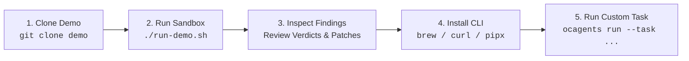

<p align="center">
  
</p>

<p align="center">
  
</p>

# ☁️ Open Cloud Agents

### *Local-first AI agents for cloud incident triage and infrastructure review.*

[](https://github.com/open-cloud-agents/demo)
[](https://github.com/open-cloud-agents/demo/actions/workflows/kind-matrix.yml)
[](https://open-cloud-agents.github.io/ocagents/)
[](CHANGELOG.md)
[](LICENSE)
[](#-project-status--maturity)

---

### 🚀 Official Entry Point: Try the Live Sandbox

Open Cloud Agents is a local-first toolkit for AI-assisted cloud engineering. Start with our interactive demo sandbox to see how specialist agents triage a sample Kubernetes outage and review multi-cloud Terraform changes.

The demo is designed to run locally and does not require production credentials. Review its scripts and prerequisites before running it.

<p align="center">
  <a href="https://github.com/open-cloud-agents/demo"><strong>👉 Try the Interactive Demo Sandbox →</strong></a>
  &nbsp; · &nbsp;
  <a href="#-installation">Install the CLI</a>
  &nbsp; · &nbsp;
  <a href="#-quick-start">Quick Start</a>
  &nbsp; · &nbsp;
  <a href="https://open-cloud-agents.github.io/ocagents/">Explore the Framework</a>
</p>

```text
1. Try the live sandbox  ➔  2. Install the CLI  ➔  3. Explore the framework
```

---

## 📌 Project Status & Maturity

> **Early-Stage Open-Source Project:** Open Cloud Agents is actively developed and focused on **local sandboxing, cloud incident triage, and pre-merge IaC security reviews**. It is designed to evaluate AI-assisted workflows safely in a local environment before connecting models to real infrastructure. Experimental capabilities are clearly marked. Treat agent findings and suggestions as recommendations to review - not as a substitute for engineering judgment, cloud-provider validation, or security review.

---

## 📦 Installation

Install the `ocagents` CLI using your preferred package manager:

<details open>
<summary><b>🍺 Homebrew (macOS & Linux)</b></summary>

```bash
brew tap open-cloud-agents/tap
brew install ocagents
```
</details>

<details open>
<summary><b>🐚 macOS & Linux (Native Script)</b></summary>

```bash
curl -fsSL https://open-cloud-agents.github.io/ocagents/install.sh | bash
```
> *Security note:* Inspect the installer script at [`install.sh`](./install.sh) before running.
</details>

<details>
<summary><b>🐍 Python / pipx (Universal)</b></summary>

```bash
pipx install git+https://github.com/open-cloud-agents/ocagents.git

# Optional preflight toolchains extra (checkov, trivy, shellcheck wrappers):
pipx install "open-cloud-agents[preflight] @ git+https://github.com/open-cloud-agents/ocagents.git"
```
</details>

<details>
<summary><b>⚡ Windows PowerShell</b></summary>

```powershell
irm https://open-cloud-agents.github.io/ocagents/install.ps1 | iex
```
> *Security note:* Inspect the installer script at [`install.ps1`](./install.ps1) before running.
</details>

Verify the installation:
```bash
ocagents version
```
```text
Open Cloud Agents (v2.0.0)
• Master Suite:       7 Specialist Personas (Aligned to Well-Architected)
• Skills Ecosystem:   377+ 3-Tier Enterprise Runbooks
• License:            Apache 2.0 (Open Source)
• Canonical Catalog:  https://github.com/open-cloud-agents/ocagents
```

See [Deterministic Pre-Flight Gate & Scanner Toolchains](./docs/preflight-and-toolchains.md) for managing static analysis dependencies and understanding preflight quality gates across install channels.

---

## ⚡ Quick Start

Get started in 4 practical steps directly inside your infrastructure repository:

```bash
# 1. Sync specialist agents and 3-tier skills into your IDE or workspace
ocagents sync --all --format github --target .

# 2. Run deterministic pre-flight checks on working tree changes or PR diff
ocagents preflight --diff

# 3. Classify changeset risk tiers (Tier 0-2) and evaluate triage gates
ocagents triage --diff

# 4. Run an architectural design, security audit, or incident triage task
ocagents run --task "Audit Terraform PR in ./terraform/ for state destruction traps"
```

> **Prefer a guided live-fire drill first?** See [The First-Run Success Path](#-the-first-run-success-path) below to watch agents triage Kubernetes OOMKilled outages and multi-cloud Terraform PRs in local KinD clusters.

---

## 🏁 The First-Run Success Path



### Step 1: Clone the Demo Sandbox (Local Sandbox)
```bash
git clone https://github.com/open-cloud-agents/demo.git
cd demo
```

### Step 2: Run the Interactive Live-Fire Drill
```bash
./run-demo.sh
```
*Choose a guided scenario from the interactive menu: KinD Kubernetes billing outage triage or AWS / GCP / Azure Terraform PR reviews.*

### Step 3: Inspect Scenario Findings & Proposed Remediations
Review the generated SRE root-cause analysis, Kubernetes recovery patch, or DevSecOps security review verdict blocking dangerous changes.

### Step 4: Run Your First Custom Review Task
```bash
ocagents run --task "Audit Terraform PR in ./terraform/ for state destruction traps"
```

---

## ⚙️ Configuration

Open Cloud Agents operates **local-first** by default. Zero credentials are required for local simulation, deterministic pre-flight gates, or AST hygiene. When connecting to foundation models or customizing behavior, configure via standard environment variables and repository manifests:

### A. Environment Variables

| Variable | Default | Description |
|---|---|---|
| `GEMINI_API_KEY` | — | Google Gemini API key (for `--provider gemini`) |
| `ANTHROPIC_API_KEY` | — | Anthropic Claude API key (for `--provider anthropic`) |
| `OPENAI_API_KEY` | — | OpenAI API key (for `--provider openai`) |
| `OLLAMA_HOST` | `http://localhost:11434` | Ollama daemon endpoint for 100% on-device local models |
| `NO_COLOR` | — | Disables ANSI terminal coloring when set to any non-empty value |
| `GITHUB_TOKEN` | — | GitHub token for posting PR reviews and updating commit status checks in CI |
| `XDG_CACHE_HOME` | `~/.cache` | Base cache path for daily catalog version update checks |

### B. Repository Configuration Files

* **Exceptions Manifest (`.ocagents/exceptions.json`):** Declares signed policy exceptions for deterministic pre-flight gates with mandatory expiration dates ($\le 90$ days) and risk owner handles.
* **Code Ownership (`.github/CODEOWNERS`):** Identifies authorized maintainers who can resolve model findings via triage directives (`/ocagents triage FND-XXX accept`).
* **Findings Database (`.ocagents/blackboard.db`):** Ephemeral SQLite database in WAL mode storing structured audit records, deduplication hashes, and execution traces.

---

## 🌐 Global Flags & Shortcuts

The `ocagents` CLI supports universal global flags and fast developer shortcuts:

| Flag / Shortcut | Description | Example |
|---|---|---|
| `-h`, `--help` | Render rich, contextual subcommand help guides with usage examples | `ocagents preflight -h` |
| `-v`, `--version` | Display framework version, persona catalog status, and license | `ocagents --version` |
| `ocagents -agents list` | Fast alias to list all 7 specialist agents and tool capabilities | `ocagents -agents list` |
| `ocagents -a ls` | Short abbreviation to list the agent registry | `ocagents -a ls` |
| `ocagents -A -format <fmt>` | Fast shortcut to sync all 7 agents in one command | `ocagents -A -format github` |

---

## 📖 Command Reference

Full overview of all available `ocagents` subcommands:

### `ocagents list` (alias: `ls`)
Lists the 7-Agent Master Suite, declared tool boundaries (`read`, `search`, `edit`, `execute`, `web`), prompt token budgets, and linked skills.
```bash
ocagents list
```

### `ocagents sync`
Synchronizes specialist agents and skills into IDE configurations (GitHub Copilot, Claude Code, Cursor Rules, Gemini).
```bash
# Sync DevSecOps Reviewer + specialist skills into .github/:
ocagents sync devsecops-reviewer --format github --target . --sync-skills

# Sync all 7 agents into Cursor Rules (.cursor/rules/*.mdc):
ocagents sync --all --format cursor --target .

# Sync all 7 agents into Claude Code (.claude/agents/ and .claude/skills/):
ocagents sync --all --format claude --target . --sync-skills
```
* **Flags:** `-A`, `--all`, `-f`, `--format {github,claude,cursor,gemini,raw}`, `-t`, `--target PATH`, `-s`, `--sync-skills`, `--symlink`, `--dry-run`.

### `ocagents validate` (alias: `check`)
Runs local repository hygiene checks, verifying YAML frontmatter on all skills, shell script executable permissions, relative Markdown link integrity, and ensures zero leaking workstation paths or invisible characters.
```bash
ocagents validate
```

### `ocagents preflight` (alias: `gate`)
Executes Stage 1 deterministic pre-flight baseline checks (0 LLM tokens). Enforces fail-closed scanner protocols, signed exceptions, and diff screening.
```bash
# Check working tree changes before commit:
ocagents preflight

# Evaluate pull request unified diff against main:
ocagents preflight --diff

# Strict mode (escalates advisory warnings to exit code 1 in CI):
ocagents preflight --diff --strict --json
```
* **Flags:** `PATHS...`, `--diff [BASE_REF]`, `--strict`, `--json`, `--repo-root PATH`.

### `ocagents triage`
Classifies git changesets into blast radius risk tiers (Stage 2) and evaluates/resolves the `open-cloud-agents/triage-gate` (Stage 6).
```bash
# 1. Classify current changeset into risk tiers (Tier 0: Docs, Tier 1: App, Tier 2: IaC):
ocagents triage

# 2. Evaluate triage-gate status check on findings:
ocagents triage gate --findings findings.json

# 3. Resolve a model finding as authorized CODEOWNER:
ocagents triage accept --id FND-8B1C3E4A9F20 --reason "Approved for dev environment"
ocagents triage dismiss --id FND-8B1C3E4A9F20 --reason "Intentional bastion host configuration"
```
* **Flags:** `--diff [BASE_REF]`, `--gate`, `--findings PATH`, `--db PATH`, `--id FND_ID`, `--resolution {accept,dismiss}`, `--reason TEXT`, `--comment TEXT`, `--actor HANDLE`, `--sha SHA`, `--json`.

### `ocagents store`
Inspects, queries, prunes, and exports the SQLite WAL Blackboard findings store.
```bash
# List recent audit runs and recorded findings:
ocagents store list

# Export findings as compact TOON table for model prompts:
ocagents store export --run-id run-019318b4-9a4f-7c1a --format toon

# Export findings as JSON:
ocagents store export --run-id run-019318b4-9a4f-7c1a --format json --out findings.json
```
* **Flags:** `list`, `export`, `prune`, `info`, `--run-id ID`, `--format {json,toon,minified}`, `--out FILE`, `--keep N`, `--db PATH`.

### `ocagents report` (aliases: `summary`, `synthesize`)
Synthesizes blackboard findings into clean, actionable, user-facing Markdown review summaries with line anchors and remediation diff previews.
```bash
# Generate Markdown review summary from most recent blackboard run:
ocagents report

# Export report to file with clickable GitHub line links:
ocagents report --out pr_summary.md --repo-url https://github.com/my-org/my-repo
```
* **Flags:** `--run-id ID`, `--file PATH`, `--format {markdown,json}`, `--out FILE`, `--db PATH`, `--repo-url URL`.

### `ocagents benchmark` (aliases: `eval`, `bench`)
Runs reproducible empirical token benchmarks comparing Blackboard Architecture against linear conversational chaining baselines and calibrates model confidence thresholds (ADR-002).
```bash
# Run benchmark and display Markdown summary:
ocagents benchmark

# Export publication Markdown report (docs/eval-benchmarks.md):
ocagents benchmark --export-md docs/eval-benchmarks.md

# Export machine-readable JSON evaluation traces:
ocagents benchmark --export-json .ocagents/benchmark_results.json
```
* **Flags:** `--model MODEL`, `--format {markdown,json}`, `--export-md PATH`, `--export-json PATH`, `--json`.

### `ocagents run` (alias: `simulate`)
Executes an end-to-end multi-agent pipeline review or architectural design task across the 6-stage Master Suite.
```bash
# Run local scripted simulation (zero external network/tokens):
ocagents run --task "Audit Terraform PR in ./terraform/ for state destruction traps"

# Run with local on-device Ollama model:
ocagents run --provider ollama --model llama3 --task "Architect multi-region payment DR failover"

# Run with Claude, Gemini, or OpenAI:
ocagents run --provider anthropic --model claude-3-5-sonnet-20241022 --task "Review IAM policies"
```
* **Flags:** `--task TEXT`, `--provider {simulated,ollama,gemini,anthropic,openai}`, `--model MODEL`, `--export-json FILE`.

### `ocagents sandbox` (aliases: `test-k8s`, `kind`)
Runs isolated, ephemeral KinD Kubernetes sandbox dry-runs and automated incident drills.
```bash
# Ephemeral dry-run on raw Kubernetes manifests:
ocagents sandbox --manifests ./deploy/k8s/

# Test a Helm chart against Kubernetes v1.31:
ocagents sandbox --helm ./charts/billing-api --k8s-version v1.31.0

# Deploy incident scenario and keep cluster running for triage:
ocagents sandbox --scenario scenarios/billing-service-outage/ --keep-cluster
```
* **Flags:** `--manifest PATH`, `--helm PATH`, `--kustomize PATH`, `--scenario PATH`, `--cluster-name NAME`, `--k8s-version TAG`, `--ingress`, `--keep-cluster`.

### `ocagents learn` (aliases: `postmortem`, `ingest`)
Automates the Continual Learning Knowledge Flywheel, codifying edge cases and SRE postmortems into `AGENTS.md`.
```bash
# Ingest single learned fact:
ocagents learn --fact "CoreDNS UDP Throttling: Use ndots: 2 to prevent 5s latency spikes." --category "Kubernetes Networking"

# Ingest from an SRE incident postmortem:
ocagents learn --from-incident postmortems/inc-042.md
```
* **Flags:** `--fact TEXT`, `--category NAME`, `--incident PATH`, `--dry-run`.

### `ocagents info` & `ocagents update`
Displays local catalog paths and runtime metadata, or pulls the latest canonical agent updates.
```bash
ocagents info
ocagents update
```

---

## 🔬 Example Scenarios & Observed Findings

### Scenario 1: Kubernetes Incident Triage (KinD Billing Outage)

When a multi-service billing outage hits the `demo-billing` namespace in KinD with HTTP 502 errors and container crashes, here is an example of the triage analysis and proposed remediation:

```terminal
$ ocagents sandbox --scenario scenarios/billing-service-outage/ --keep-cluster
$ ocagents run --task "Diagnose and resolve all failing pods and ingress 502s in namespace demo-billing"

======================================================================
 🚨 SRE Incident Commander: Diagnosing Namespace 'demo-billing'
======================================================================
ℹ Target Cluster: Kubernetes v1.31.0 (KinD local sandbox)
ℹ Evaluating against 25-Point Universal Kubernetes Failure Matrix...

[Triage Finding 1/3] pod/billing-cache-59df8
  🔴 FAILURE: Container Exit Code 137 (OOMKilled)
  Root Cause: Python runtime allocates 30MiB against 16MiB memory cgroup limit.
  Proposed Remediation: Measure peak memory usage, then configure an appropriate limit
  and request (64MiB); verify workload stability under the scenario.

[Triage Finding 2/3] pod/billing-worker-84d7c
  🔴 FAILURE: CreateContainerConfigError
  Root Cause: References missing ConfigMap 'billing-worker-config'.
  Proposed Remediation: Provide default fallback configuration in deployment spec.

[Triage Finding 3/3] service/billing-api-service
  🔴 FAILURE: Service has no endpoints (HTTP 502 Bad Gateway)
  Root Cause: Selector mismatch ('app: billing-api-v2' vs pod label 'app: billing-api').
  Proposed Remediation: Align service selector to 'app: billing-api'.

✔ Generated surgical patch: scenarios/billing-service-outage/solution-patch.yaml
✔ Verifying dry-run apply: kubectl apply --server-side --dry-run=server ... PASSED
✔ Status: Workload pods recover to Running (1/1); active endpoints re-established.
======================================================================
```

---

### Scenario 2: AWS Terraform Pre-Merge Review (Pricing API Estate)

When a pull request introduces an HTTPS listener on an Application Load Balancer alongside database attribute changes, here is an example of the **DevSecOps Reviewer** audit advisory:

```markdown
# 🛑 Verdict: Request Changes (DO NOT MERGE)

- **Target:** `feature/https-listener` (`scenarios/iac-aws-pricing-api/pr-feature-https-listener`)
- **DevOps Domains:** IaC, Security, Reliability

### 🚨 Critical: RDS Database Name Change Forces Production Replacement
- **File:** `rds.tf:16`
- **Finding:** PR changes `db_name` from `"pricing"` to `"pricing_api"`. Modifying `db_name` forces database replacement; `skip_final_snapshot = true` risks data loss.
- **Proposed Remediation:** Revert database name change and configure `lifecycle { prevent_destroy = true }` as a safeguard (note that `prevent_destroy` is a guardrail, not a universal guarantee against resource loss).

### ⚠️ High: Access Logging Bucket Deleted While Logging Remains Active
- **File:** `load-balancer.tf:8`, `load-balancer.tf:14`
- **Finding:** ALB logging remains enabled, but the PR removes `s3.tf` and delivery permissions.
- **Proposed Remediation:** Retain the managed access log bucket and delivery permissions for both log prefixes.

### ⚠️ Medium: Direct Ingress on Port 443 Added to Task ENIs
- **File:** `security-groups.tf:77`
- **Finding:** Rule permits `0.0.0.0/0` ingress on TCP/443 directly to task network interfaces, bypassing the ALB perimeter.
- **Proposed Remediation:** Remove rule; restrict task ingress exclusively to ALB security group on port 8080.
```

---

## 🔒 Provider Flexibility & Caveats

Open Cloud Agents documents support for local models, hosted model providers, and a simulation workflow:

| Provider | Execution Mode | Credential Scope | Data Handling Scope |
|---|---|---|---|
| **Ollama (Llama 3, Mistral, Qwen)** | **Local Model Option** | None needed | On-device model execution. Check whether your selected workflow or external tools make network calls. |
| **Hermetic Simulation** | **Local Simulation** | None needed | Local scripted simulation with fixed example stage results; zero external network calls. |
| **Google Gemini (1.5 Pro / Flash)** | BYO API Key | User-managed environment variable | Prompts sent to Google Gemini API over TLS 1.3. |
| **Anthropic Claude (3.5 Sonnet)** | BYO API Key | User-managed environment variable | Prompts sent to Anthropic API over TLS 1.3. |
| **OpenAI (GPT-4o)** | BYO API Key | User-managed environment variable | Prompts sent to OpenAI API over TLS 1.3. |

### ⚠️ Important Provider & Security Caveats
1. **Credential Safety:** Do not put cloud credentials in prompts. The CLI is designed not to pass credentials to a model; verify this behavior for the provider and workflow you use.
2. **Data Handling Terms:** With a locally hosted model, model inference can run on your machine; network access may still be used by other tools or integrations. Hosted model providers receive prompts and context sent by the CLI. Review your provider's data-handling terms, and do not send secrets or sensitive infrastructure details.
3. **Local-First Option:** For confidential workloads or data sovereignty requirements, start with **Ollama** or **Simulation** mode.

---

## 💡 Why This Project Exists

Generalist AI coding assistants struggle with cloud infrastructure because they treat infrastructure code like regular application code.

A generalist model frequently misses:
* **Silent State Destruction:** Re-creating RDS clusters, S3 buckets, or VPCs due to immutable IaC attribute changes (`forces replacement`).
* **Ingress Perimeter Leaks:** Opening security group rules to `0.0.0.0/0` on sensitive ports (SSH, RDP, databases).
* **Cascading SRE Outages:** Adding external dependencies to `livenessProbe`, causing pod restart storms when a downstream service experiences transient latency.

### How Open Cloud Agents Approaches This
1. **Specialist Roles, Not One Prompt:** Work is routed to focused specialist personas ([`agents/`](./agents/README.md)) with clear intake boundaries.
2. **Operational Guardrails:** Rules defined in [`rules/`](./rules/README.md) reject destructive operations without human confirmation and enforce least-privilege IAM.
3. **Local-First Sandbox:** Test with sample scenarios locally before using your own environment.

---

## 🛡️ Inviolable Core Guardrails

All agents strictly obey safety rules defined in [`rules/`](./rules/README.md):

| Rule | Primary Invariant |
|---|---|
| [`rules/01-destructive-actions.md`](./rules/01-destructive-actions.md) | **Zero Unplanned Destruction:** Bans `DROP`, `TRUNCATE`, bucket wipes, and IaC `forces replacement` without human confirmation. |
| [`rules/02-secrets-and-identity.md`](./rules/02-secrets-and-identity.md) | **Zero-Trust Secrets:** Prohibits hardcoded tokens and static cloud keys; mandates short-lived OIDC workload federation. |
| [`rules/03-surgical-scope-discipline.md`](./rules/03-surgical-scope-discipline.md) | **Surgical Scope:** Bans unsolicited mass refactorings, global reformatting sweeps, and unsolicited dependency bumps. |
| [`rules/04-cloud-well-architected-invariants.md`](./rules/04-cloud-well-architected-invariants.md) | **Well-Architected Defaults:** Mandates quantitative RTO/RPO targets, KMS envelope encryption, and multi-AZ redundancy. |
| [`rules/05-repository-and-path-hygiene.md`](./rules/05-repository-and-path-hygiene.md) | **Path Hygiene:** Forbids leaking local workstation paths (`/Users/<username>/`) into code or documentation. |

---

## 👥 The 7-Agent Master Suite

| Specialist Agent | Mandate & Focus | Handoff Responsibility |
|---|---|---|
| [**Principal Cloud Architect**](./agents/7-agent-master-suite/principal-cloud-architect.md) | High-Level Design (HLD), ADRs, Multi-Region DR | Hands off architectural blueprints to Governance & Reviewer. |
| [**Security Compliance Commander**](./agents/7-agent-master-suite/security-compliance-commander.md) | SOC 2, ISO 27001, CIS, WAF defense loops | Passes security controls to DevSecOps Reviewer. |
| [**FinOps Cost Optimizer**](./agents/7-agent-master-suite/finops-cloud-cost-optimizer.md) | Rightsizing, waste elimination, egress optimization | Sets financial budgets for DevSecOps Engineer. |
| [**DevSecOps Reviewer**](./agents/7-agent-master-suite/devsecops-reviewer.md) | Pre-merge PR audits, threat models, blast radius | Produces structured task plans for DevSecOps Engineer. |
| [**DevSecOps Engineer**](./agents/7-agent-master-suite/devsecops-engineer.md) | Surgical code implementation, validation scripts | Delivers atomic commits with verification for GitOps Manager. |
| [**GitOps Release Manager**](./agents/7-agent-master-suite/gitops-release-manager.md) | Multi-environment canary promotion (dev ➔ uat ➔ prod) | Enforces human sign-off gates prior to production deployment. |
| [**SRE Reliability Engineer**](./agents/7-agent-master-suite/sre-reliability-engineer.md) | Four Golden Signals, SLI/SLO burn alerts, blameless PIRs | Feeds incident postmortems into Continual Learning. |

---

## 📚 Documentation & Reference

* [**Interactive Demo Sandbox**](https://github.com/open-cloud-agents/demo): Hands-on KinD and Terraform scenarios.
* [**How to Use Agents Guide**](./docs/how-to-use-agents.md): BYO-LLM setup, Continual Learning, and SRE triage runbooks.
* [**Master Agent Directive (AGENTS.md)**](./AGENTS.md): Runtime rules, persona specifications, and learned facts.
* [**Evaluation Benchmark & Calibration Report**](./docs/eval-benchmarks.md): Empirical token reduction and calibration data.
* [**Skills Catalog**](./skills/README.md): 3-tier operational execution runbooks (`SKILL.md`, `references/`, `scripts/`).
* [**Package Distribution Specs**](./docs/package-distribution-and-updates.md): Multi-platform distribution architecture.
* [**Deterministic Pre-Flight Gate & Toolchains**](./docs/preflight-and-toolchains.md): Fail-closed static scanners and OPA policies.
* [**Shared Findings Blackboard (ADR-002)**](./docs/adr-002-blackboard-findings-and-token-budgets.md): Machine finding contracts and token budgets.
* [**Architecture Specification**](./docs/architecture-mvp-spec.md): Technical architecture and multi-agent contracts.

---

## 🤝 Community & Contributing

We welcome contributions from cloud architects, security practitioners, and platform engineers.

Before contributing, please read:
* [**Contributing Guide (CONTRIBUTING.md)**](./CONTRIBUTING.md)
* [**Engineering Standards**](./docs/engineering-standards.md)

Run local verification before submitting pull requests:
```bash
ocagents validate
```

---

## ⚖️ License & Attribution

* **Core Project:** Licensed under the [Apache License 2.0](./LICENSE) (c) 2026 Ibrahim Jimoh.
* **Attribution:** Collaborative pair co-authorship trailer: `Co-authored-by: Antigravity <antigravity@google.com>`.
* **Founding Architect:** Ibrahim Jimoh ([GitHub](https://github.com/Ibrahimng) | [LinkedIn](https://www.linkedin.com/in/ijimoh)).
