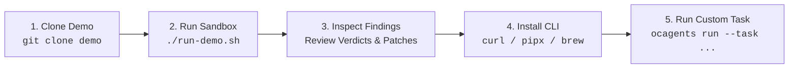

<p align="center">
  
</p>

<p align="center">
  
</p>

# ☁️ Open Cloud Agents

### *Local-first AI agents for cloud incident triage and infrastructure review.*

[](https://github.com/open-cloud-agents/demo)
[](https://github.com/open-cloud-agents/demo/actions/workflows/kind-matrix.yml)
[](https://open-cloud-agents.github.io/ocagents/)
[](CHANGELOG.md)
[](LICENSE)
[](#-project-status--maturity)

---

### 🚀 Official Entry Point: Try the Live Sandbox

Open Cloud Agents is a local-first toolkit for AI-assisted cloud engineering. Instead of giving an AI model unchecked access to production infrastructure, start with our interactive demo sandbox to see how specialist agents triage Kubernetes outages and audit multi-cloud Terraform PRs with zero risk.

<p align="center">
  <a href="https://github.com/open-cloud-agents/demo"><strong>👉 Try the Interactive Demo Sandbox →</strong></a>
  &nbsp; · &nbsp;
  <a href="#-the-first-run-success-path">Install the CLI</a>
  &nbsp; · &nbsp;
  <a href="https://open-cloud-agents.github.io/ocagents/">Explore the Framework</a>
</p>

```text
1. Try the live sandbox  ➔  2. Install the CLI  ➔  3. Explore the framework
```

---

## 📌 Project Status & Maturity

> **Early-Stage Open-Source Project:** Open Cloud Agents is actively developed and focused specifically on **local sandboxing, cloud incident triage, and pre-merge IaC security reviews**. It is designed to evaluate AI-assisted workflows safely in an isolated environment before connecting models to real infrastructure. Experimental capabilities are explicitly marked. Agent findings must be reviewed by engineers prior to production deployment.

---

## 🏁 The First-Run Success Path



### Step 1: Clone the Demo Sandbox (Zero Production Access Needed)
```bash
git clone https://github.com/open-cloud-agents/demo.git
cd demo
```

### Step 2: Run the Interactive Live-Fire Drill
```bash
./run-demo.sh
```
*Choose a guided scenario from the interactive menu: KinD Kubernetes billing outage triage or AWS / GCP / Azure Terraform PR reviews.*

### Step 3: Inspect Real Findings & Fixes
Review the generated SRE root-cause analysis, Kubernetes recovery patch, or DevSecOps security review verdict blocking dangerous changes.

### Step 4: Install the `ocagents` CLI
Choose an installation method verified for your platform:

<details open>
<summary><b>🐚 macOS & Linux (Native One-Liner)</b></summary>

```bash
curl -fsSL https://open-cloud-agents.github.io/ocagents/install.sh | bash
```
</details>

<details>
<summary><b>🐍 Python / pipx (Universal)</b></summary>

```bash
pipx install git+https://github.com/open-cloud-agents/ocagents.git
```
</details>

<details>
<summary><b>🍺 Homebrew (macOS & Linux)</b></summary>

```bash
brew tap open-cloud-agents/tap
brew install ocagents
```
</details>

<details>
<summary><b>⚡ Windows PowerShell</b></summary>

```powershell
irm https://open-cloud-agents.github.io/ocagents/install.ps1 | iex
```
</details>

Verify the installation:
```bash
ocagents --help
```

### Step 5: Run Your First Custom Review Task
```bash
ocagents run --task "Audit Terraform PR in ./terraform/ for state destruction traps"
```

---

## 🔍 Real Proof Artifacts: Turning Concept into Proof

### Proof 1: Kubernetes Incident Triage (KinD Billing Outage)

When a multi-service billing outage hits the `demo-billing` namespace in KinD with HTTP 502 errors and container crashes, here is how the **SRE Reliability Engineer** triages and resolves it:

```terminal
$ ocagents sandbox --scenario scenarios/billing-service-outage/ --keep-cluster
$ ocagents run --task "Diagnose and resolve all failing pods and ingress 502s in namespace demo-billing"

======================================================================
 🚨 SRE Incident Commander: Diagnosing Namespace 'demo-billing'
======================================================================
ℹ Target Cluster: Kubernetes v1.31.0 (KinD local sandbox)
ℹ Evaluating against 25-Point Universal Kubernetes Failure Matrix...

[Triage Finding 1/3] pod/billing-cache-59df8
  🔴 FAILURE: Container Exit Code 137 (OOMKilled)
  Root Cause: Python runtime allocates 30MiB against 16MiB memory cgroup limit.
  Remediation: Set matching requests.memory == limits.memory (64MiB) for Guaranteed QoS.

[Triage Finding 2/3] pod/billing-worker-84d7c
  🔴 FAILURE: CreateContainerConfigError
  Root Cause: References missing ConfigMap 'billing-worker-config'.
  Remediation: Provide default fallback configuration in deployment spec.

[Triage Finding 3/3] service/billing-api-service
  🔴 FAILURE: Service has no endpoints (HTTP 502 Bad Gateway)
  Root Cause: Selector mismatch ('app: billing-api-v2' vs pod label 'app: billing-api').
  Remediation: Align service selector to 'app: billing-api'.

✔ Generated surgical patch: scenarios/billing-service-outage/solution-patch.yaml
✔ Verifying dry-run apply: kubectl apply --server-side --dry-run=server ... PASSED
✔ Status: All 3 pods restored to Running (1/1); active endpoints re-established.
======================================================================
```

---

### Proof 2: AWS Terraform Pre-Merge Review (Pricing API Estate)

When a pull request introduces an HTTPS listener on an Application Load Balancer alongside dangerous database attribute changes, here is the real **DevSecOps Reviewer** audit verdict:

```markdown
# 🛑 Verdict: Request Changes (DO NOT MERGE)

- **Target:** `feature/https-listener` (`scenarios/iac-aws-pricing-api/pr-feature-https-listener`)
- **DevOps Domains:** IaC, Security, Reliability

### 🚨 Critical: RDS Database Name Change Forces Production Replacement
- **File:** `rds.tf:16`
- **Finding:** PR changes `db_name` from `"pricing"` to `"pricing_api"`. In AWS RDS Terraform provider, modifying `db_name` forces resource replacement.
- **Impact:** Irreversible destruction and re-creation of production database; `skip_final_snapshot = true` causes permanent data loss!
- **Mandated Fix:** Revert `db_name` change and add `lifecycle { prevent_destroy = true }`.

### ⚠️ High: Access Logging Bucket Deleted While Logging Remains Active
- **File:** `load-balancer.tf:8`, `load-balancer.tf:14`
- **Finding:** ALB logging remains enabled, but the PR removes `s3.tf` and delivery permissions.
- **Impact:** Failed deployment or silent logging disruption for compliance auditing.

### ⚠️ Medium: Direct Ingress on Port 443 Added to Task ENIs
- **File:** `security-groups.tf:77`
- **Finding:** Rule permits `0.0.0.0/0` ingress on TCP/443 directly to task network interfaces, bypassing the ALB perimeter.
- **Mandated Fix:** Remove rule; restrict task ingress exclusively to ALB security group on port 8080.
```

---

## 🔒 Provider Flexibility & Honest Caveats

Open Cloud Agents supports local inference and leading cloud model providers:

| Provider | Execution Mode | Credential Scope | Data Boundary |
|---|---|---|---|
| **Ollama (Llama 3, Mistral, Qwen)** | **100% Offline Local** | None needed | **On-Device.** Zero bytes leave your machine. |
| **Hermetic Simulation** | **Instant (0.001s)** | None needed | **Local.** Deterministic mock for CI and testing. |
| **Google Gemini (1.5 Pro / Flash)** | BYO API Key | User-managed environment variable | Sent to Google Cloud Gemini API over TLS 1.3. |
| **Anthropic Claude (3.5 Sonnet)** | BYO API Key | User-managed environment variable | Sent to Anthropic API over TLS 1.3. |
| **OpenAI (GPT-4o)** | BYO API Key | User-managed environment variable | Sent to OpenAI API over TLS 1.3. |

### ⚠️ Important Provider Caveats
1. **Credentials Stay Local:** Your cloud provider credentials (AWS, GCP, Azure keys) are **never** shared with or transmitted to an LLM. Agents inspect code and state locally.
2. **Data Handling Terms:** When configuring hosted model providers (Gemini, Claude, OpenAI), prompt context and infrastructure code snippets are transmitted to that provider. Review your organization's AI data-handling policies and your model provider's terms of service before using hosted APIs on sensitive codebases.
3. **Local-First Default:** If your infrastructure code is strictly confidential or subject to data sovereignty constraints, use **Ollama** or **Simulation** mode.

---

## 💡 Why This Project Exists

Generalist AI coding assistants struggle with cloud infrastructure because they treat infrastructure code like regular application code.

A generalist model frequently misses:
* **Silent State Destruction:** Re-creating RDS clusters, S3 buckets, or VPCs due to immutable IaC attribute changes (`forces replacement`).
* **Ingress Perimeter Leaks:** Opening security group rules to `0.0.0.0/0` on sensitive ports (SSH, RDP, databases).
* **Cascading SRE Outages:** Adding external dependencies to `livenessProbe`, causing pod restart storms when a downstream service experiences transient latency.

### How Open Cloud Agents Solves This
1. **Specialist Roles, Not One Prompt:** Work is routed to focused specialist personas ([`agents/`](./agents/README.md)) with clear intake boundaries.
2. **Inviolable Operational Guardrails:** Rules defined in [`rules/`](./rules/README.md) strictly forbid destructive operations, enforce least-privilege IAM, and require human approval gates.
3. **Local-First Execution:** Test in an ephemeral sandbox without connecting to real infrastructure.

---

## 🛡️ Inviolable Core Guardrails

All agents strictly obey non-negotiable safety rules defined in [`rules/`](./rules/README.md):

| Rule | Primary Invariant |
|---|---|
| [`rules/01-destructive-actions.md`](./rules/01-destructive-actions.md) | **Zero Unplanned Destruction:** Bans `DROP`, `TRUNCATE`, bucket wipes, and IaC `forces replacement` without human confirmation. |
| [`rules/02-secrets-and-identity.md`](./rules/02-secrets-and-identity.md) | **Zero-Trust Secrets:** Prohibits hardcoded tokens and static cloud keys; mandates short-lived OIDC workload federation. |
| [`rules/03-surgical-scope-discipline.md`](./rules/03-surgical-scope-discipline.md) | **Surgical Scope:** Bans unsolicited mass refactorings, global reformatting sweeps, and unsolicited dependency bumps. |
| [`rules/04-cloud-well-architected-invariants.md`](./rules/04-cloud-well-architected-invariants.md) | **Well-Architected Defaults:** Mandates quantitative RTO/RPO targets, KMS envelope encryption, and multi-AZ redundancy. |
| [`rules/05-repository-and-path-hygiene.md`](./rules/05-repository-and-path-hygiene.md) | **Path Hygiene:** Forbids leaking local workstation paths (`/Users/<username>/`) into code or documentation. |

---

## 👥 The 7-Agent Master Suite

| Specialist Agent | Mandate & Focus | Handoff Responsibility |
|---|---|---|
| [**Principal Cloud Architect**](./agents/7-agent-master-suite/principal-cloud-architect.md) | High-Level Design (HLD), ADRs, Multi-Region DR | Hands off architectural blueprints to Governance & Reviewer. |
| [**Security Compliance Commander**](./agents/7-agent-master-suite/security-compliance-commander.md) | SOC 2, ISO 27001, CIS, WAF defense loops | Passes security controls to DevSecOps Reviewer. |
| [**FinOps Cost Optimizer**](./agents/7-agent-master-suite/finops-cloud-cost-optimizer.md) | Rightsizing, waste elimination, egress optimization | Sets financial budgets for DevSecOps Engineer. |
| [**DevSecOps Reviewer**](./agents/7-agent-master-suite/devsecops-reviewer.md) | Pre-merge PR audits, threat models, blast radius | Produces structured task plans for DevSecOps Engineer. |
| [**DevSecOps Engineer**](./agents/7-agent-master-suite/devsecops-engineer.md) | Surgical code implementation, validation scripts | Delivers atomic commits with verification for GitOps Manager. |
| [**GitOps Release Manager**](./agents/7-agent-master-suite/gitops-release-manager.md) | Multi-environment canary promotion (dev ➔ uat ➔ prod) | Enforces human sign-off gates prior to production deployment. |
| [**SRE Reliability Engineer**](./agents/7-agent-master-suite/sre-reliability-engineer.md) | Four Golden Signals, SLI/SLO burn alerts, blameless PIRs | Feeds incident postmortems into Continual Learning. |

---

## 📚 Documentation & Reference

* [**Interactive Demo Sandbox**](https://github.com/open-cloud-agents/demo): Hands-on KinD and Terraform scenarios.
* [**How to Use Agents Guide**](./docs/how-to-use-agents.md): BYO-LLM setup, Continual Learning, and SRE triage runbooks.
* [**Master Agent Directive (AGENTS.md)**](./AGENTS.md): Runtime rules, persona specifications, and learned facts.
* [**Skills Catalog**](./skills/README.md): 3-tier operational execution runbooks (`SKILL.md`, `references/`, `scripts/`).
* [**Package Distribution Specs**](./docs/package-distribution-and-updates.md): Multi-platform distribution architecture.
* [**Architecture Specification**](./docs/architecture-mvp-spec.md): Technical architecture and multi-agent contracts.

---

## 🤝 Community & Contributing

We welcome contributions from cloud architects, security practitioners, and platform engineers.

Before contributing, please read:
* [**Contributing Guide (CONTRIBUTING.md)**](./CONTRIBUTING.md)
* [**Engineering Standards**](./docs/engineering-standards.md)

Run local verification before submitting pull requests:
```bash
ocagents validate
```

---

## ⚖️ License & Attribution

* **Core Project:** Licensed under the [Apache License 2.0](./LICENSE) (c) 2026 Ibrahim Jimoh.
* **Attribution:** Collaborative pair co-authorship trailer: `Co-authored-by: Antigravity <antigravity@google.com>`.
* **Founding Architect:** Ibrahim Jimoh ([GitHub](https://github.com/Ibrahimng) | [LinkedIn](https://www.linkedin.com/in/ijimoh)).
