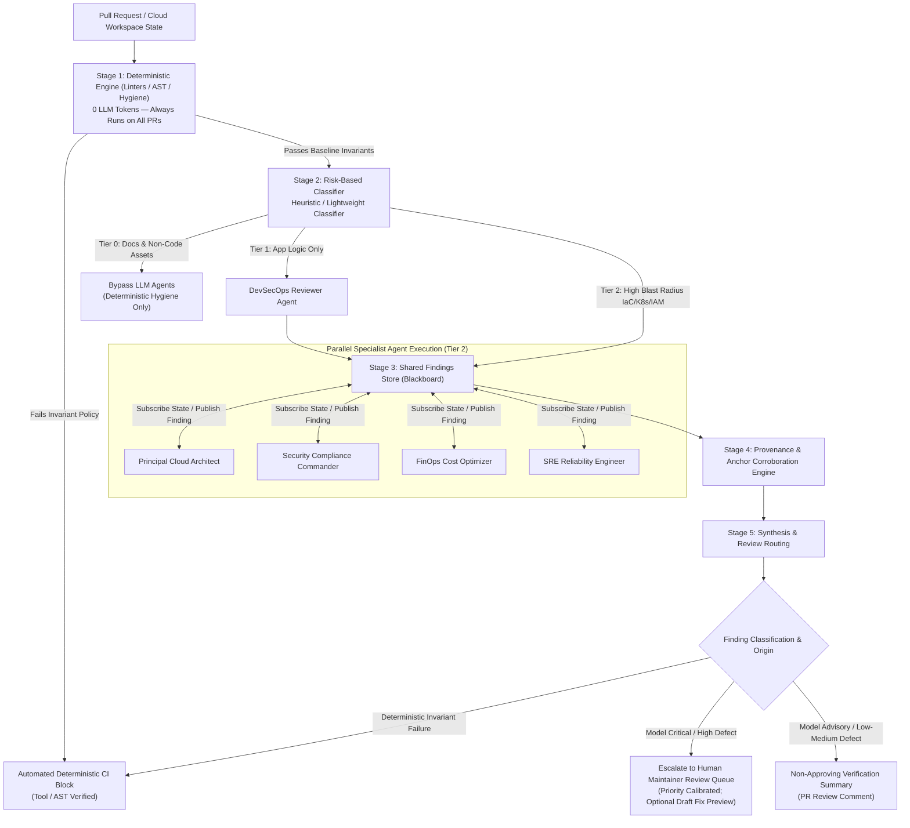

# ADR-002: Shared Structured Findings Store & Token-Budgeted Blackboard Architecture

* **Status:** Accepted (Target: Open Cloud Agents v2.0)
* **Date:** 2026-11-04
* **Deciders:** Principal Cloud Architect, DevSecOps Reviewer, SRE Reliability Engineer
* **Consulted:** Founding Architect, Community Contributors
* **Supersedes / Extends:** [Architecture MVP Spec](./architecture-mvp-spec.md), [Token Optimization Architecture](./token-optimization-architecture.md), [Engineering Standards](./engineering-standards.md)

---

## 1. Context & Problem Statement

In early iterations of multi-agent engineering frameworks (including Open Cloud Agents v1.x), agent collaboration relies predominantly on **sequential narrative handoffs**:

```text
[Architect Agent] ──(1,200 tok narrative)──► [Security Agent] ──(2,500 tok narrative)──► [FinOps / SRE Agent]
```

While effective for isolated demonstrations, this pattern suffers from three systemic failure modes at enterprise scale:

1. **Compounding Token Inflation ($O(N^2)$ Context Growth):**
   As each specialist agent adds observations, the accumulated conversational transcript saturates model context windows. In long conversational chains, downstream agents can spend an estimated majority of their context budget (e.g. an illustrative 50% to 70% in deep reviews) re-reading earlier narrative prose rather than evaluating cloud resources.
2. **"Telephone Game" Information Degradation:**
   Conversational prose introduces subjective drift (*"I believe this architecture might..."*). Downstream agents build arguments upon subjective impressions rather than verifiable infrastructure facts, increasing hallucination rates.
3. **Expensive LLM Evaluation of Deterministic Rules:**
   Invoking high-parameter foundation models to check boolean conditions (e.g., `kms_key_id == null` or missing `prevent_destroy`) burns millions of tokens on questions that static analysis or policy-as-code engines answer locally in milliseconds at zero token cost.

---

## 2. Decision Drivers

* **Predictable Token Economics:** Token consumption must be an architectural SLA, not an operational afterthought.
* **Deterministic Baseline Guardrails (v2.0 Target Requirement):** All supported in-catalog static, syntactic, and repository hygiene rules are targeted to execute prior to LLM invocation.
* **Auditability & Grounded Provenance:** Every finding must anchor to a verified source line, valid rule catalog identifier, and corroboration status.
* **Evidence-Based CI Gating:** Automated CI blocks must rest on deterministic rules or verified evidence—never solely on uncalibrated model confidence.
* **Elimination of False-Positive Fatigue:** Model-generated findings serve to prioritize human review queues rather than autonomously blocking PRs.

---

## 3. Considered Alternatives

| Pattern | Description | Pros | Cons / Why Rejected |
|---|---|---|---|
| **A. Linear Conversational Chaining** | Agents converse in a shared chat thread. | Intuitive to implement; natural language flexibility. | Context explosion, cumulative drift, high token cost. |
| **B. Centralized Orchestrator Routing** | Single "Manager Agent" breaks tasks and calls specialists. | Clear hierarchy. | The Manager becomes a token bottleneck and single point of failure; prone to instruction loss. |
| **C. Blackboard Architecture (Shared Findings Store)** | Specialist agents independently read infrastructure state and publish structured findings to an append-only store. | Hypothesized sub-linear token scaling (dependent on findings summarization strategy), verifiable schemas, decoupled agents. | **Selected as canonical target.** |

---

## 4. Architectural Specification



---

### Pillar 1: The Canonical Finding Schema & Provenance Engine

Specialist agents are strictly forbidden from communicating in free-form narrative prose. All evaluations must emit valid JSON complying with the **Open Cloud Agents Finding Schema** (`schemas/v1/finding.json`):

```json
{
  "$schema": "https://open-cloud-agents.github.io/schemas/v1/finding.json",
  "id": "SEC-AZ-042",
  "agent": "security-compliance-commander",
  "origin": "model_assertion",
  "rule_id": "rules/04-cloud-well-architected-invariants.md",
  "category": "Network Isolation & Private Connectivity",
  "resource": "azurerm_key_vault.prod",
  "fact": "Key Vault public network access enabled without virtual network subnet restrictions",
  "evidence": "diff:terraform/keyvault.tf#L24-L26",
  "recommendation": "Set public_network_access_enabled = false and attach private_endpoint",
  "severity": "high",
  "confidence": 0.94,
  "corroboration_status": "unverified_model_claim",
  "remediation": {
    "proposed_draft_available": true,
    "diff_preview": "- public_network_access_enabled = true\n+ public_network_access_enabled = false"
  }
}
```
*(Illustrative model-authored finding mapping to Rule 04 network isolation standards)*

#### Fact / Evidence / Recommendation Invariant
Every finding must cleanly separate:
1. **Fact:** Verifiable assertion regarding resource configuration (AST or configuration value).
2. **Evidence:** Explicit locator URI identifying the source code lines or cloud resource.
3. **Recommendation:** Prescriptive remediation action without conversational pleasantries.

#### Nullable Confidence Invariant
The `confidence` field is typed as `float | null`:
* **Deterministic Findings (`origin: "deterministic_linter"`):** Emitted by AST linters, static analyzers, or repo hygiene scripts. Because tool-matched checks are binary invariant evaluations, `confidence` is explicitly set to `null` (or omitted).
* **Model Assertions (`origin: "model_assertion"`):** Emitted by specialist LLMs. The `confidence` field is a required float $[0.00, 1.00]$, representing the model's self-assessed certainty used strictly to prioritize human review queues.

#### Runtime Provenance & Multi-Target Corroboration Engine
Schema validation verifies field structure and types, but cannot verify whether `rule_id` is an actual policy, whether `evidence` points to real code or cloud resources, or whether `fact` is true. The runtime corroboration layer parses the evidence locator scheme prefix (`diff:`, `repo:`, `cloud:`) to enforce ground-truth checks tailored to the target type before storing findings:

1. **Rule Catalog Integrity:** Verifies `rule_id` against the canonical repository rules catalog (`rules/`). Unknown rule IDs are rejected with `provenance_error: "invalid_rule_id"`.
2. **Multi-Target Evidence Anchor Verification:**
   * **Diff Evidence (`diff:<relative_path>#L<start>-L<end>`):** Points to added or modified lines in the active changeset. The runtime verifies that the file is part of the PR diff and that the line range intersects modified lines. Hallucinated file paths or line ranges trigger `provenance_error: "invalid_diff_anchor"`.
   * **Repository Baseline Evidence (`repo:<relative_path>#L<start>-L<end>`):** Points to contextual lines in the repository workspace at the target commit hash (e.g., referencing an existing unchanged VPC configuration). The runtime verifies that the file and line range exist in the commit tree.
   * **Live Cloud Resource Evidence (`cloud:<provider>:<resource_identifier>`):** Points to an external cloud resource (e.g. `cloud:azure:/subscriptions/.../vaults/prod-vault`, `cloud:aws:arn:aws:kms:...`). Validated for syntactical resource identifier format. When read-only cloud integrations are enabled, verified against cloud provider resource APIs; when running offline or without cloud credentials, labeled as `corroboration_status: "syntactically_valid_unverified_resource"`.
3. **Corroboration Status Labeling:** Model-authored findings are stamped with `corroboration_status: "unverified_model_claim"` until independently confirmed by a deterministic tool or human maintainer (`"verified"`).

#### Strict Remediation Boundary
Remediation diffs or draft PRs produced by agents are strictly **proposals**. They are **never** automatically merged, applied, or deployed. Any proposed fix must pass all deterministic checks and requires mandatory human maintainer review and explicit approval.

---

### Pillar 2: First-Class Token Budgeting as Architecture

Every agent specification in `agents/7-agent-master-suite/` must declare immutable token ceilings in its YAML frontmatter:

```yaml
---
name: security-compliance-commander
role: Security Compliance & Cyber Defense Commander
token_budget:
  max_context_tokens: 4500
  max_output_tokens: 600
  max_session_total_tokens: 8000
handoff_contract:
  input_schema: schemas/v1/resource_state.json
  output_schema: schemas/v1/finding.json
  max_payload_tokens: 350
tools: [read, search, execute, web]
---
```
*(All specialist agents emit findings conforming to the canonical base schema `schemas/v1/finding.json`. Specialist-specific schemas such as `security_finding.json` extend the base schema by declaring optional domain metadata while preserving all core invariants.)*

* **Build-Time Verification:** `agent_pipeline.py --validate` checks declared prompt token budgets as structural approximations (`~4 characters per token`).
* **Runtime Tokenizer Accounting:** At runtime, enforcement uses the selected provider's native tokenizer where available (e.g. `tiktoken`, Anthropic count API).
* **Cumulative Session Budget:** Retries triggered by malformed outputs or schema errors count against `max_session_total_tokens`, preventing bounded retry loops from evading the token ceiling.
* **Rejection Over Truncation:** If an agent emits invalid or oversized JSON, the runtime **must not truncate** the payload (which turns structured output into corrupt syntax). The runtime rejects the payload and initiates a bounded retry with schema error diagnostics, or escalates the run to human review.

---

### Pillar 3: Deterministic Pre-Flight Gate (The Cost-Reduction Funnel)

To protect model budgets and enforce non-negotiable boundaries, the pipeline executes in three sequential stages:

#### Supported Static Scope & Inventory (v2.0 Target Requirements)

A "supported check" is defined as an enabled scanner in the Open Cloud Agents catalog that recognizes the input file format (e.g. `validate_repo.py` for repository hygiene, `shellcheck` for `.sh`, `checkov`/`trivy` for `.tf`/`.yaml`).

* **Supported File Types:** `.tf`, `.yaml`, `.yml`, `.json`, `.sh`, `.py`, `.md`.
* **Tool Inventory:** Repository hygiene (`scripts/ci/validate_repo.py`), diff screening (`scripts/ci/audit_pr_diff.py`), and configured linters (`shellcheck`, `checkov`, `trivy`, `semgrep`).
* **Fail-Closed Scanner Availability Protocol:**
  When a scanner configured for the changeset is missing from the execution environment, crashes, or fails to parse target files, the pipeline enforces strict fail-closed semantics based on tool requirement level:
  * **Required Scanner Missing or Failed (`INCOMPLETE_CHECK_FAILED`):** If a mandatory baseline scanner (e.g., repository hygiene `validate_repo.py` or required IaC security checkers on infrastructure diffs) is unavailable or fails execution, the pipeline **stops immediately before LLM execution**. The run terminates with status `INCOMPLETE_CHECK_FAILED`, blocking CI verification. Under no circumstance may an incomplete run report a green or verified audit result; CI remains blocked until the required tool executes successfully or an authorized, cryptographically signed exception is recorded in repository configuration.
  * **Advisory Scanner Missing (`INCONCLUSIVE_PARTIAL_AUDIT`):** If an optional or advisory scanner is missing, the tool runner emits finding status `SKIPPED_SCANNER_UNAVAILABLE` with diagnostic error traces. The pipeline may proceed to downstream LLM review stages, but the final CI verification status is irrevocably marked `INCONCLUSIVE_PARTIAL_AUDIT`. Downstream consumers and human reviewers are explicitly warned that static coverage was degraded.
  * **Zero False-Clean Invariant:** An uninspected file, skipped check, or unavailable scanner must **never** yield a passing, clean, or approved audit verdict.

#### Staged Execution Flow
1. **Stage 1: Always-Run Deterministic Baseline (0 LLM Tokens):**
   * Static linters, secret scanning, and invisible confusable checks run on *all* pull requests (including documentation and asset changes).
   * Violations of inviolable rules (e.g. hardcoded credentials, unquoted runner expressions) trigger an immediate **Automated Deterministic CI Block** without invoking an LLM.
2. **Stage 2: Risk-Based Triage Classifier:**
   * Evaluates the blast radius of the Git diff:
     * **Tier 0 (Documentation & Non-Code Assets):** Documentation, formatting, image assets $\rightarrow$ bypass specialist LLM agents entirely.
     * **Tier 1 (Application Code Only):** Application source code without IaC $\rightarrow$ DevSecOps Reviewer only.
     * **Tier 2 (High Blast Radius Infrastructure):** Terraform, CloudFormation, Kubernetes manifests, IAM policies, network routing $\rightarrow$ activate full Master Suite blackboard.
3. **Stage 3: Specialist Agent Blackboard Execution:**
   * Specialist agents evaluate the parsed diff and publish structured findings to the shared store.

---

### Pillar 4: Evidence-Based CI Gating & Calibrated Review Routing

Automated CI blocks must rest on **deterministic rules or verified evidence**, not uncalibrated model confidence. Model confidence varies across model providers and cannot be treated as mathematical proof of correctness.

In accordance with the Nullable Confidence Invariant, deterministic findings emit `confidence: null` with `origin: "deterministic_linter"`. Conversely, model assertions emit `origin: "model_assertion"` with a float confidence value utilized strictly to **prioritize human review queues** and calibrate triage urgency:

| Finding Origin | Severity | Confidence Value (`float \| null`) | Routing Action | Enforcement Policy |
|---|---|---|---|---|
| **Deterministic Invariant** (`deterministic_linter`) | Critical / High | `null` (Tool-Verified Invariant) | **Automated CI Gate Block** | Deterministic rule violation; halts automated checks and blocks CI. |
| **Model Assertion** (`model_assertion`) | Critical / High | $\ge 0.85$ (High Confidence) | **Human Escalation (P0 / Urgent)** | High-priority maintainer review; **never auto-blocks CI on model opinion alone**. |
| **Model Assertion** (`model_assertion`) | Critical / High | $< 0.85$ (Uncertain) | **Human Escalation (P1 / Review)** | High risk with elevated uncertainty; flagged with confidence disclaimer. |
| **Model Assertion** (`model_assertion`) | Medium / Low | $\ge 0.75$ (High Confidence) | **Advisory PR Comment (P2)** | Structured non-approving verification comment posted for author review. |
| **Model Assertion** (`model_assertion`) | Medium / Low | $< 0.75$ (Uncertain) | **Diagnostic Audit Log (P3)** | Retained in the run execution log for audit traceability. |

> **Provisional Triage Defaults:** The confidence thresholds above ($\ge 0.85$, $< 0.85$, $\ge 0.75$, $< 0.75$) represent initial operational triage defaults. These thresholds are provisional and must be empirically calibrated against a versioned evaluation dataset before being relied upon for operational routing.

> **Strict Non-Approval Invariant:** Automated verification workflows running under automated bots post structured verification summaries strictly as non-approving review comments (`event: 'COMMENT'`). Formal pull request approval (`event: 'APPROVE'`) is reserved exclusively for human maintainers.

---

## 5. Consequences & Architectural Hypotheses

### Positive & Expected Capabilities
* **Hypothesized Token Efficiency:** Multi-agent pipeline token consumption is hypothesized to drop by **65% to 80%**, as downstream agents consume structured findings rather than concatenated narrative transcripts. *(Note: This is an architectural hypothesis subject to empirical verification on a versioned evaluation benchmark before becoming an official project claim.)*
* **Enhanced Traceability via Schemas & Corroboration:** Schema validation guarantees structural field completeness and data typing, while catalog checks and the multi-target corroboration engine verify rule IDs and evidence anchors. Structured schemas prevent parse errors, but do not guarantee that model-generated assertions are factually true; independent tool corroboration and human verification remain essential.
* **Predictable, Evidence-Gated CI:** Automated gates fail strictly on verified deterministic checks, eliminating arbitrary CI breakages caused by uncalibrated model hallucinations.
* **Audit Support Traceability:** Stored findings may support audit evidence collection by preserving structured records of review findings and provenance; they do not establish compliance or replace formal control testing and human auditor review.

### Trade-Offs & Mitigations
* **Schema Rigidity:** Requires strict JSON schema validation on model outputs; models with poor instruction-following must be handled via bounded retry strategies, not raw truncation.
* **Staged Implementation:** The current CLI simulation does not yet implement the live findings blackboard; transition must proceed through staged releases ([v2.0 Roadmap](./roadmap.md)).

---

## 6. Implementation Milestones

Detailed release milestones, exit criteria, and testing boundaries are formalized in the **[Open Cloud Agents v2.0 Roadmap](./roadmap.md)**:
* **v1.x:** Establish trustworthy baseline, accurate documentation, and transparent simulation status.
* **v1.4:** Structured findings contracts (`schemas/v1/finding.json`) and anchor corroboration checks.
* **v1.5:** Deterministic pre-flight checks and tool result normalization with fail-closed semantics.
* **v1.6:** Risk-based triage classifier and local append-only findings store.
* **v2.0:** Integrated shared findings workflow, provider integrations, and policy routing.

