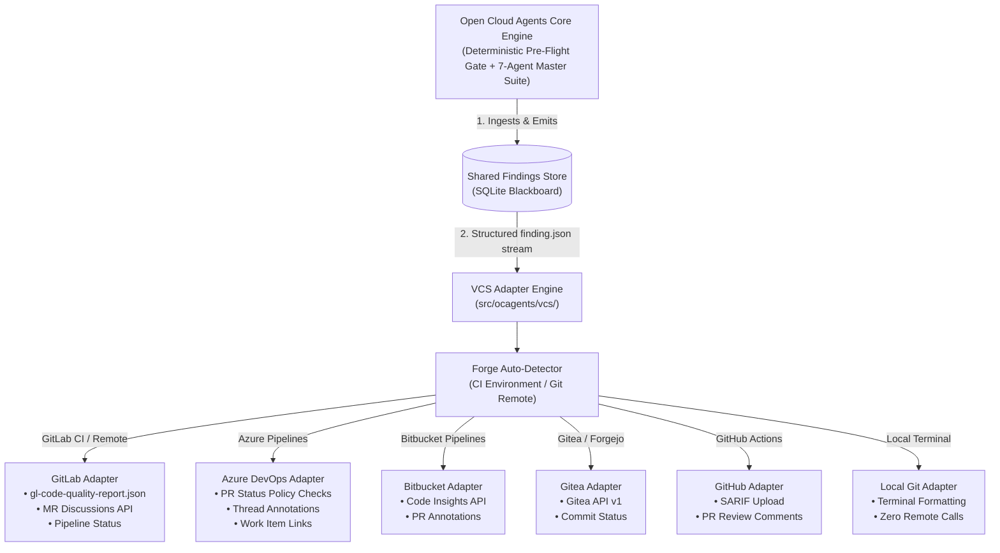

# ADR-003: Multi-VCS Provider Adapter Engine & Universal Forge Integration

* **Status:** Accepted (Target: Open Cloud Agents v2.1)
* **Date:** 2026-11-17
* **Deciders:** Principal Cloud Architect, DevSecOps Reviewer, GitOps Release Manager
* **Consulted:** Founding Architect, Community Contributors
* **Supersedes / Extends:** [ADR-002: Blackboard Architecture](./adr-002-blackboard-findings-and-token-budgets.md), [Token Optimization Architecture](./token-optimization-architecture.md), [Engineering Standards](./engineering-standards.md)

---

## 1. Context & Problem Statement

In Open Cloud Agents v1.x and v2.0, the automated pull request review pipeline, pre-merge gates, and update registries were predominantly coupled to **GitHub**:
- Git hosting assumptions: `https://github.com/open-cloud-agents/ocagents.git`
- Automated triage gating: GitHub Actions workflows (`.github/workflows/`), GitHub Pull Request Comments, and the `gh` CLI.
- Security and quality dashboards: GitHub Code Scanning SARIF uploads (`github/codeql-action/upload-sarif`).

However, across enterprise cloud computing, government infrastructure, defense networks, and sovereign cloud regions, over **50% of the production market operates on non-GitHub version control systems**:

1. **GitLab (SaaS & Self-Managed):** The predominant platform for European sovereign clouds, defense contractors, telecommunications providers, and on-premises air-gapped VPCs where SaaS code hosting is prohibited by data residency mandates.
2. **Azure DevOps (ADO):** The default enterprise platform for Microsoft-aligned financial institutions, healthcare providers, and global enterprises orchestrating multi-stage release pipelines into Azure and hybrid cloud estates.
3. **Bitbucket (Cloud & Data Center):** Heavily entrenched in enterprise environments standardizing on the Atlassian lifecycle (Jira, Confluence, Atlassian Teamwork Graph).
4. **Gitea & Forgejo:** The preferred lightweight, self-hosted forge for edge computing, privacy-sensitive research institutions, homelabs, and isolated offline installations.

To deliver on its mandate as a **universal cloud governance and multi-agent engineering platform**, Open Cloud Agents must decouple its deterministic engine and findings blackboard from GitHub and provide a first-class, **forge-agnostic Multi-VCS Provider Adapter Engine**.

---

## 2. Decision Drivers

* **Enterprise Market Coverage:** Unlock compliance and autonomous review capabilities for the ~50% of enterprises on GitLab, Azure DevOps, and Bitbucket.
* **Air-Gapped & Sovereign Cloud Invariance:** Enable 100% offline or air-gapped operation in AWS GovCloud, Azure Government, and isolated private clouds without external SaaS egress.
* **Native Developer Experience:** Embed review findings directly into each platform's native merge request widgets (e.g. GitLab Code Quality diffs, Azure DevOps PR status policies, Bitbucket Code Insights) rather than forcing developers to read external logs.
* **Provider Decoupling (Open-Closed Principle):** Core agent evaluation, deterministic pre-flight checks, and findings storage must remain completely agnostic of the underlying repository forge.

---

## 3. Considered Alternatives

| Pattern | Description | Pros | Cons / Why Rejected |
|---|---|---|---|
| **A. Separate Toolchain Binaries** | Distribute distinct CLI binaries (`ocagents-gitlab`, `ocagents-ado`). | Simple per-binary dependencies. | Severe release overhead, fragmented codebase, duplicate bug reports. |
| **B. GitHub-Centric Middleware Proxy** | Require users to mirror their repos to a headless GitHub instance. | Zero changes to existing GitHub Actions. | Completely unacceptable to regulated enterprises; introduces data exfiltration vectors. |
| **C. Universal Provider Adapter Interface** | A unified `VCSProvider` abstract base class with pluggable forge implementations and automatic environment detection. | Single binary, zero cross-forge coupling, clean test mocking, universal CLI. | **Selected as canonical target.** |

---

## 4. Architectural Specification

### 4.1 System Topology



---

### 4.2 Core `VCSProvider` Interface Definition

All forge integrations implement the abstract interface defined in `src/ocagents/vcs/base.py`:

```python
from abc import ABC, abstractmethod
from typing import List, Dict, Any, Optional
from pathlib import Path

class VCSProvider(ABC):
    """Abstract base contract for version control and code review forges."""

    @abstractmethod
    def detect_context(self) -> bool:
        """Returns True if the current runtime or git repository matches this forge."""
        pass

    @abstractmethod
    def get_diff(self, base_ref: str, head_ref: str) -> str:
        """Retrieves the unified git diff between base and head references."""
        pass

    @abstractmethod
    def post_pr_summary(self, pr_id: str, summary_markdown: str) -> bool:
        """Publishes or updates the high-level review summary comment on the PR/MR."""
        pass

    @abstractmethod
    def post_inline_annotations(self, pr_id: str, findings: List[Dict[str, Any]]) -> int:
        """Publishes line-level annotations/discussions on changed code files."""
        pass

    @abstractmethod
    def set_commit_status(
        self,
        sha: str,
        state: str,  # 'success', 'failed', 'pending'
        description: str,
        context: str = "ocagents/quality-gate",
        target_url: Optional[str] = None
    ) -> bool:
        """Sets the platform commit status or build check result."""
        pass

    @abstractmethod
    def export_native_artifacts(self, findings: List[Dict[str, Any]], output_dir: Path) -> List[Path]:
        """Exports platform-native artifacts (e.g. gl-code-quality-report.json, sarif)."""
        pass
```

---

### 4.3 Forge Capability & Output Matrix

| Feature / Artifact | GitHub | GitLab (SaaS & Self-Managed) | Azure DevOps | Bitbucket (Cloud & DC) | Gitea / Forgejo |
|---|---|---|---|---|---|
| **CI Environment Detection** | `GITHUB_ACTIONS=true` | `GITLAB_CI=true` | `TF_BUILD=True` | `BITBUCKET_BUILD_NUMBER` | `GITEA_ACTIONS=true` |
| **Auth Tokens** | `GITHUB_TOKEN` | `GITLAB_TOKEN` / `CI_JOB_TOKEN` | `SYSTEM_ACCESSTOKEN` | `BITBUCKET_TOKEN` | `GITEA_TOKEN` |
| **Inline Annotations** | Checks API Annotations | Merge Request Discussions | PR Thread Comments | Code Insights Annotations | Commit / PR Comments |
| **Native Report Artifact** | SARIF v2.1.0 | `gl-code-quality-report.json` | SARIF v2.1.0 | Code Insights Report JSON | Markdown / Console |
| **Blocking Policy Gates** | Required Status Checks | Merge Checks (`needs_approval`) | Pull Request Status Policy | Merge Checks Policy | Branch Protection Checks |

---

### 4.4 Air-Gapped & Sovereign Cloud Guarantees

For compliance-restricted environments:
1. **Offline Zero-Egress Operation:** When running in an air-gapped environment (indicated by `--offline` or presence of `CI_SERVER_HOST`), the CLI suppresses all outbound update checks and telephone telemetry.
2. **Local Model Endpoints:** Integrates transparently with private endpoints (`OPENAI_BASE_URL` pointing to local vLLM, Ollama, or private AWS Bedrock VPC endpoints).
3. **No External SaaS Tokens:** All repository interactions leverage ephemeral CI job tokens (`CI_JOB_TOKEN`, `SYSTEM_ACCESSTOKEN`) with zero hardcoded credentials.

---

## 5. Phased Rollout Plan

1. **Phase 1: Architecture & Interface Foundation (v2.1)**
   - Abstract `VCSProvider` base class and auto-detection engine (`src/ocagents/vcs/`).
   - `LocalGitAdapter` fallback for offline developer CLI usage.
2. **Phase 2: GitLab Integration & CI Component (v2.1)**
   - `GitLabAdapter` with REST v4 API and GitLab Code Quality artifact generator (`gl-code-quality-report.json`).
   - Official `.gitlab-ci.yml` reusable component.
3. **Phase 3: Azure DevOps Pipelines Task (v2.2)**
   - `AzureDevOpsAdapter` supporting ADO REST API 7.x, PR thread annotations, and status check policies.
   - Azure Pipelines extension/task.
4. **Phase 4: Bitbucket & Gitea/Forgejo (v2.3)**
   - Bitbucket Code Insights pipe.
   - Gitea Actions compatibility.
