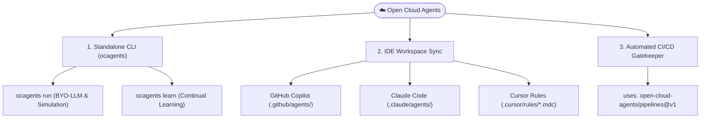

# 🛠️ How to Use Open Cloud Agents

Welcome to the comprehensive operational guide for **Open Cloud Agents**. This runbook demonstrates how to execute, configure, and orchestrate the 7-Agent Master Suite across your local terminal, IDEs, and CI/CD pipelines.

---

## ⚡ Three Ways to Use Open Cloud Agents



---

## 🚀 1. Standalone CLI: Multi-Agent Execution & BYO-LLM

The `ocagents run` command executes an architectural design, security audit, or incident triage task through the 6-stage Master Suite pipeline:
1. `Principal Cloud Architect` ➔ 2. `Security & FinOps Governance` ➔ 3. `DevSecOps Reviewer` ➔ 4. `DevSecOps Engineer` ➔ 5. `GitOps Release Manager` ➔ 6. `SRE Incident Commander`.

### A. Bring Your Own LLM (BYO-LLM) Providers

You can route tasks to offline local models or your preferred managed cloud provider using the `--provider` and `--model` flags:

=== "Local-First / Offline (Ollama)"
    Run completely local and offline with zero external network or token costs:
    ```bash
    # 100% offline, local-first using your local Ollama daemon:
    ocagents run --provider ollama --model llama3 --task "Architect multi-region payment DR failover"
    ```

=== "Google Gemini"
    ```bash
    # Set your API key:
    export GEMINI_API_KEY="your-gemini-key"

    # Run with Gemini:
    ocagents run --provider gemini --model gemini-1.5-pro --task "Architect multi-region payment DR failover"
    ```

=== "Anthropic Claude"
    ```bash
    # Set your API key:
    export ANTHROPIC_API_KEY="your-anthropic-key"

    # Run with Anthropic:
    ocagents run --provider anthropic --model claude-3-5-sonnet-20241022 --task "Architect multi-region payment DR failover"
    ```

=== "OpenAI"
    ```bash
    # Set your API key:
    export OPENAI_API_KEY="your-openai-key"

    # Run with OpenAI:
    ocagents run --provider openai --model gpt-4o --task "Architect multi-region payment DR failover"
    ```

=== "Hermetic Simulation (Default)"
    ```bash
    # Default: Runs the lightning-fast (0.001s) deterministic simulation with zero external API keys needed:
    ocagents run --task "Architect zero-downtime payments failover with Aurora Global Database"
    ```

### B. Exporting Structured Execution Traces

Export the end-to-end multi-agent interaction to a persistent JSON artifact for auditability or compliance records:

```bash
ocagents run \
  --task "Architect active-active payment ledger" \
  --export-json /path/to/execution_trace.json
```

---

## 🧠 2. Continual Learning: Ingesting Runtime Facts (`ocagents learn`)

The `ocagents learn` command automates the **Knowledge Flywheel**, codifying newly discovered edge cases, bug mitigations, and postmortems directly into the persistent [`AGENTS.md`](../AGENTS.md) dynamic knowledge base.

### Ingest a Single Learned Fact

```bash
# Ingest a learned fact into a target category in AGENTS.md:
ocagents learn \
  --fact "CoreDNS UDP Throttling: Use ndots: 2 to prevent 5s latency spikes." \
  --category "Kubernetes Networking"
```

### Ingest from an Incident Postmortem (PIR)

```bash
# Preview ingestion from an incident report without modifying files:
ocagents learn --incident postmortems/inc-042.md --dry-run

# Ingest an SRE postmortem directly into the knowledge base:
ocagents learn --from-incident postmortems/INC-2026-10-outage.md
```

> [!TIP]
> The Continual Learning Engine automatically deduplicates against existing entries, attaches the fact under the matching category header in `AGENTS.md`, and runs repository validation to ensure zero formatting regressions.

---

## 🚨 3. Real-World Incident Triage: SRE Pod Failure Analysis

You can task the **SRE Reliability Engineer** and **DevSecOps Reviewer** with diagnosing production outages and triaging any of the [25 Universal Kubernetes Failure States](../skills/devops/kubernetes/k8s-pod-troubleshooting/references/k8s-production-troubleshooting-cheatsheet.md):

```bash
# SRE Agent analyzes pod failure:
ocagents run --task "Triage pod checkout-api-7b89f in CrashLoopBackOff with Exit Code 137 and 502 Ingress spikes"
```

### What the Agent Evaluates Autonomously:
1. **Exit Code 137:** Identifies container `OOMKilled` event; recommends matching `requests.memory == limits.memory` to obtain **Guaranteed QoS**.
2. **502 Ingress Spikes:** Detects race condition between `SIGTERM` and endpoint removal; applies `lifecycle.preStop: exec: command: ["/bin/sh", "-c", "sleep 10"]`.
3. **DNS Latency:** Identifies CoreDNS UDP conntrack contention; applies `ndots: 2` and `single-request-reopen`.

---

## 💻 4. IDE Pair Programming: Workspace Synchronization (`ocagents sync`)

Synchronize specialist agent personas and 3-tier skills into your local repository workspace:

### Sync for GitHub Copilot & VS Code
```bash
# Sync DevSecOps Reviewer + 9 specialist skills into .github/:
ocagents sync devsecops-reviewer --format github --target . --sync-skills

# Sync all 7 agents:
ocagents sync -A --format github --target .
```
**In GitHub Copilot Chat:**
```text
@workspace Review my open Terraform PR for state destruction traps using #file:devsecops-reviewer.md
```

### Sync for Claude Code
```bash
# Sync for Claude Code (.claude/agents/ and .claude/skills/):
ocagents sync devsecops-reviewer --format claude --target . --sync-skills
```
**In Claude Code CLI:**
```bash
claude "Read and adopt .claude/agents/devsecops-reviewer.md to audit our terraform/ directory for security and cost risks."
```

### Sync for Cursor
```bash
# Export all 7 agents into Cursor Rules (.cursor/rules/*.mdc):
ocagents sync -A --format cursor --target .
```
**In Cursor Chat:**
```text
@devsecops-reviewer.mdc Audit our AWS payment infrastructure against Well-Architected guardrails.
```

---

## 🛡️ 5. Pre-Merge CI/CD Gatekeeper (GitHub Actions)

Add Open Cloud Agents to your repository's `.github/workflows/pr.yml` in 3 lines:

```yaml
steps:
  - name: Checkout Code
    uses: actions/checkout@v7

  - name: Run Open Cloud Agents DevSecOps Gatekeeper
    uses: open-cloud-agents/pipelines@v1
    with:
      enable-iac-audit: true
      enable-ai-safety: true
      enable-secret-scan: true
```

---

## 📚 Related Documentation
- [Master Agent Directive (AGENTS.md)](../AGENTS.md)
- [7-Agent Master Suite Catalog](../agents/README.md)
- [25 Kubernetes Production Failure States](../skills/devops/kubernetes/k8s-pod-troubleshooting/references/k8s-production-troubleshooting-cheatsheet.md)
- [Advanced Cluster & Control Plane Failure Runbook](../skills/devops/kubernetes/k8s-pod-troubleshooting/references/k8s-advanced-cluster-and-control-plane-triage.md)
- [Skills Ecosystem Catalog](../skills/README.md)
- [Package Distribution & CLI Updates](./package-distribution-and-updates.md)

