<p align="center">
  
</p>

# ☁️ Open Cloud Agents

### *Local-first AI agents for safer cloud architecture, security review, and production operations.*

**Open Cloud Agents** helps teams use AI more safely for cloud work. Instead of one overloaded generalist chatbot, it routes tasks to specialist agents for architecture review, IaC security analysis, release governance, operational resilience, and cloud cost optimization.

---

### Built for:
- **Cloud architects**
- **Platform engineering teams**
- **Security and compliance reviewers**
- **SRE teams**
- **Teams that want AI without giving up local control**

---

## 💡 Why It Exists

Most AI tools fail in real cloud environments because they try to do too much with one prompt.

Cloud work requires:
- **Specialized reasoning**
- **Rule-based safety controls**
- **Architecture trade-off analysis**
- **Controlled delivery flows**
- **Production guardrails**

Open Cloud Agents separates these concerns into **agents**, **skills**, and **rules** so the system behaves more like a disciplined engineering team than a single hallucinating assistant.

---

## ⚡ Core Capabilities

- **Architecture review and design guidance**
- **Security and compliance analysis**
- **IaC and PR risk review**
- **Release and deployment governance**
- **SRE and reliability checks**
- **FinOps and waste analysis**

---

## 🔒 Local-First and BYO-LLM

Most enterprise engineering teams cannot send proprietary infrastructure code, network topologies, or cloud credentials to closed, third-party AI platforms. 

**Open Cloud Agents is local-first by design.** Your codebase, IaC state, and compliance policies never leave your boundary—whether you are working on a local workstation, in an air-gapped environment, or on a private CI/CD runner.

---

### 🛡️ Core Sovereignty Pillars

| Dimension | How Open Cloud Agents Works | Traditional AI Coding Platforms |
|---|---|---|
| **Data Boundary** | **100% On-Device / In-VPC.** Runs on your machine or private self-hosted runners. | Transmits codebase context to multi-tenant cloud servers. |
| **Model Choice (BYO-LLM)** | **Pluggable & Vendor-Agnostic.** Use local models (Ollama/Llama 3), enterprise APIs (Gemini, Claude, GPT-4o), or 0.001s offline simulation. | Locked into the vendor's proprietary model and pricing tier. |
| **Credential Safety** | **Zero Secret Transit.** Cloud keys and tokens stay in your local keychain or KMS; never shared with an LLM. | Requires granting broad cloud platform access tokens to third-party SaaS. |
| **Air-Gapped Ready** | **Fully Autonomous Offline.** Run reviews without internet access or external token dependencies. | Fails completely without continuous internet connectivity. |
| **Open Formats** | **Markdown & Standard Code.** Personas and skills are human-readable Markdown and shell/Python scripts. | Obfuscated system prompts, vendor-locked orchestration logic. |

---

### 🔌 Seamless Provider Flexibility

Switch between offline local inference, enterprise cloud models, or cost-free simulation with a single flag:

=== "Local Offline (Ollama)"
    ```bash
    # 100% offline and private. Zero data leaves your machine:
    ocagents run --provider ollama --model llama3 \
      --task "Audit Kubernetes cluster for state destruction traps"
    ```

=== "Google Gemini"
    ```bash
    # Direct BYO-key connection to Gemini 1.5 Pro:
    export GEMINI_API_KEY="your-gemini-key"
    ocagents run --provider gemini --model gemini-1.5-pro \
      --task "Review AWS multi-region Aurora failover topology"
    ```

=== "Anthropic Claude"
    ```bash
    # Direct BYO-key connection to Claude 3.5 Sonnet:
    export ANTHROPIC_API_KEY="your-anthropic-key"
    ocagents run --provider anthropic --model claude-3-5-sonnet \
      --task "Audit Terraform PR diff for 0.0.0.0/0 ingress risks"
    ```

=== "OpenAI"
    ```bash
    # Direct BYO-key connection to GPT-4o:
    export OPENAI_API_KEY="your-openai-key"
    ocagents run --provider openai --model gpt-4o \
      --task "Generate SRE postmortem and Prometheus SLO burn alerts"
    ```

=== "Hermetic Simulation (0 Keys Needed)"
    ```bash
    # Instant (0.001s) deterministic simulation for CI and local unit tests:
    ocagents run --task "Architect zero-downtime payments failover"
    ```

> [!NOTE]
> **Zero Vendor Lock-In:** Open Cloud Agents does not require an account, does not collect telemetry, and never forces you into a proprietary AI SaaS. You own your prompts, your workflows, your models, and your data.

---

## 👥 The Specialist Agent Model

The project organizes cloud work into specialist roles:

| Specialist Agent | Mandate & Focus |
|---|---|
| [**Principal Cloud Architect**](../agents/7-agent-master-suite/principal-cloud-architect.md) | High-Level Design (HLD), ADRs, multi-region disaster recovery, and architecture trade-offs. |
| [**Security Compliance Commander**](../agents/7-agent-master-suite/security-compliance-commander.md) | Cloud Security Hubs, Falco eBPF kernel defense, Wazuh SIEM, Sentinel, ISO 42001, and CIS audits. |
| [**DevSecOps Reviewer**](../agents/7-agent-master-suite/devsecops-reviewer.md) | Pre-merge PR audits, state destruction prevention (`forces replacement`), perimeter checks. |
| [**DevSecOps Engineer**](../agents/7-agent-master-suite/devsecops-engineer.md) | Surgical code/IaC fixes, zero-scope-creep hardening, non-destructive validation scripts. |
| [**GitOps Release Manager**](../agents/7-agent-master-suite/gitops-release-manager.md) | Multi-environment promotion (`dev` ➔ `uat` ➔ `prod`), canary rollouts, human sign-off gates. |
| [**SRE Reliability Engineer**](../agents/7-agent-master-suite/sre-reliability-engineer.md) | Four Golden Signals, SLI/SLO burn alerts, client endpoint RCA (`502/503/504`), blameless postmortems. |
| [**FinOps Cloud Cost Optimizer**](../agents/7-agent-master-suite/finops-cloud-cost-optimizer.md) | Idle waste elimination, container request rightsizing, S3 tiering, NAT egress elimination. |

Each agent has a narrow mandate, making the system easier to reason about and safer to use.

---

## 🛡️ Safety First

Open Cloud Agents is built around operational discipline:
- **No destructive actions without human approval**
- **No secret leakage**
- **No broad unscoped refactors**
- **No unsafe deployment pathways**
- **Well-architected defaults are treated as guardrails**

---

## 🚀 Quickstart

> [!TIP]
> **Try the Interactive Demo Sandbox:** Want to see the agents in action without modifying production infrastructure? Check out the [open-cloud-agents/demo](https://github.com/open-cloud-agents/demo) repository for a 60-second live-fire incident triage drill using KinD.

### Step 1: Install the CLI

Install the standalone `ocagents` CLI on your workstation or private CI runner:

=== "macOS (Homebrew)"
    ```bash
    brew tap open-cloud-agents/tap
    brew install ocagents
    ```

=== "Linux / macOS (One-Liner)"
    ```bash
    curl -fsSL https://open-cloud-agents.github.io/ocagents/install.sh | bash
    ```

=== "Python (pipx)"
    ```bash
    pipx install git+https://github.com/open-cloud-agents/ocagents.git
    ```

=== "Windows (PowerShell)"
    ```powershell
    irm https://open-cloud-agents.github.io/ocagents/install.ps1 | iex
    ```

=== "Windows (winget)"
    ```powershell
    winget install OpenCloudAgents.ocagents
    ```
    *(Pending Microsoft Community Repository verification)*

### Step 2: Verify the install
```bash
ocagents --help
```

You should see the CLI help and supported subcommands (`list`, `sync`, `validate`, `run`, `learn`, `info`).

### Step 3: Run a sample workflow
```bash
ocagents validate
```

Or run a simulated multi-agent cloud review:
```bash
ocagents simulate
```

### Step 4: Run a custom architecture task
```bash
ocagents run --task "Architect zero-downtime payments failover with Aurora Global Database"
```

---

## 🔍 Live Execution: The 5-Minute Proof Artifact

<p align="center">
  
</p>

Running `ocagents run --task "..."` triggers the 6-stage Master Suite pipeline, producing concrete architectural, security, IaC, and SRE deliverables:

```terminal
$ ocagents run --task "Architect active-active multi-region disaster recovery for transactional payment ledger"

======================================================================
 🚀 Open Cloud Agents: Multi-Agent Handoff Pipeline Execution
======================================================================
ℹ Incoming Architectural Task: 'Architect active-active multi-region disaster recovery for transactional payment ledger'

[Stage 1/6] Principal Cloud Architect: Strategic HLD & ADR Formulation
  ✔ Generated ADR (ADR-0042) with RTO < 15 minutes, RPO < 5 seconds.

[Stage 2/6] Governance Gate: Security Compliance & FinOps Optimization
  ✔ Security review approved: 3 compliance controls verified. FinOps budget baseline established.

[Stage 3/6] DevSecOps Reviewer: Defensive Threat Modeling & Blast Radius Audit
  ✔ Blast-radius audit passed. Formatted 2 surgical implementation tasks for DevSecOps Engineer.

[Stage 4/6] DevSecOps Engineer: Surgical IaC Generation & Verification
  ✔ Engineered code changes with conventional commit: 'feat(network): establish cross-region VPC peering with lifecycle state protections'.

[Stage 5/6] GitOps Release Manager: Multi-Environment Staged Promotion
  ✔ Staged canary deployment plan via ArgoCD. Production gate: AWAITING_PRODUCTION_LEAD_APPROVAL.

[Stage 6/6] SRE Reliability Incident Commander: Golden Signals & SLI/SLO Baseline
  ✔ Telemetry active: 3 Golden Signals SLIs linked to alert routing policies.
======================================================================
PIPELINE SUCCESS: All 6 stages completed in 0.001s.
======================================================================
```

??? example "View Generated Architectural Decision Record (ADR-0042)"
    ```markdown
    # ADR-0042: Active-Active Multi-Region Disaster Recovery Topology
    - Status: ACCEPTED
    - Decision: Adopt Kafka Event Spine with DynamoDB Global Tables and Cloud Run Serverless compute
    - Target RTO: < 15 minutes | Target RPO: < 5 seconds
    - Security Controls: SOC2-CC6.1, CIS-AWS-1.16, ISO27001-A.10.1 (mTLS, KMS Envelope Encryption)
    - Trade-offs: Higher cross-region replication egress cost; near-zero downtime failover.
    ```

??? example "View Generated Surgical DevSecOps IaC Diff"
    ```diff
    --- a/terraform/modules/vpc/peering.tf
    +++ b/terraform/modules/vpc/peering.tf
    @@ -0,0 +1,12 @@
    +resource "aws_vpc_peering_connection" "primary_to_secondary" {
    +  peer_owner_id = var.aws_account_id
    +  peer_vpc_id   = aws_vpc.secondary.id
    +  vpc_id        = aws_vpc.primary.id
    +  auto_accept   = false
    +
    +  # Inviolable Guardrail: Zero Unplanned Destruction
    +  lifecycle {
    +    prevent_destroy = true
    +  }
    +}
    ```

??? example "View Generated SRE Golden Signals & Alert Rules"
    ```yaml
    groups:
      - name: payment-ledger-burn-rates
        rules:
          - alert: HighErrorRateBurnRate
            expr: sum(rate(http_requests_total{status=~"5.."}[1h])) / sum(rate(http_requests_total[1h])) > 0.0005 * 14.4
            for: 2m
            labels:
              severity: critical
            annotations:
              summary: "Payment ledger 1h SLO burn rate exceeds 14.4x budget threshold"
    ```

### Step 5: Explore the docs
- **Docs site:** [https://open-cloud-agents.github.io/ocagents/](https://open-cloud-agents.github.io/ocagents/)
- **Agent catalog:** [https://open-cloud-agents.github.io/ocagents/agents/](https://open-cloud-agents.github.io/ocagents/agents/)
- **Skills catalog:** [https://open-cloud-agents.github.io/ocagents/skills/](https://open-cloud-agents.github.io/ocagents/skills/)
- **Rules and guardrails:** [https://open-cloud-agents.github.io/ocagents/rules/](https://open-cloud-agents.github.io/ocagents/rules/)

---

## 🎯 Example Use Cases

- **Review a cloud architecture** for resilience and security gaps
- **Audit Terraform or Kubernetes changes** before merge
- **Guide post-incident SRE investigation**
- **Identify wasted cloud spend**
- **Reduce risk of unsafe rollout decisions**

---

## 📚 Docs

- [**Master Agent Directive (AGENTS.md)**](../AGENTS.md)
- [**How to Use Agents (CLI, BYO-LLM & Workflows)**](./how-to-use-agents.md)
- [**Agent Reference**](../agents/README.md)
- [**Skills Catalog**](../skills/README.md)
- [**Rules and Guardrails**](../rules/README.md)
- [**Package Distribution & Updates**](./package-distribution-and-updates.md)
- [**Architecture Overview**](./architecture-mvp-spec.md)
- [**Contributing Guide**](../CONTRIBUTING.md)

---

## 🤝 Open Source and Community-Driven

Open Cloud Agents is built to be a shared engineering resource for teams working at the intersection of AI and cloud operations.

We welcome:
- New agent personas
- Better security and reliability practices
- More cloud skills
- Real-world runbooks
- Contributor improvements

### ⚖️ License & Attribution
- **License:** [Apache License 2.0](../LICENSE)
- **Co-Authorship:** `Co-authored-by: Antigravity <antigravity@google.com>`
- **Founding Architect:** Ibrahim Jimoh ([GitHub](https://github.com/Ibrahimng) | [LinkedIn](https://www.linkedin.com/in/ijimoh))

