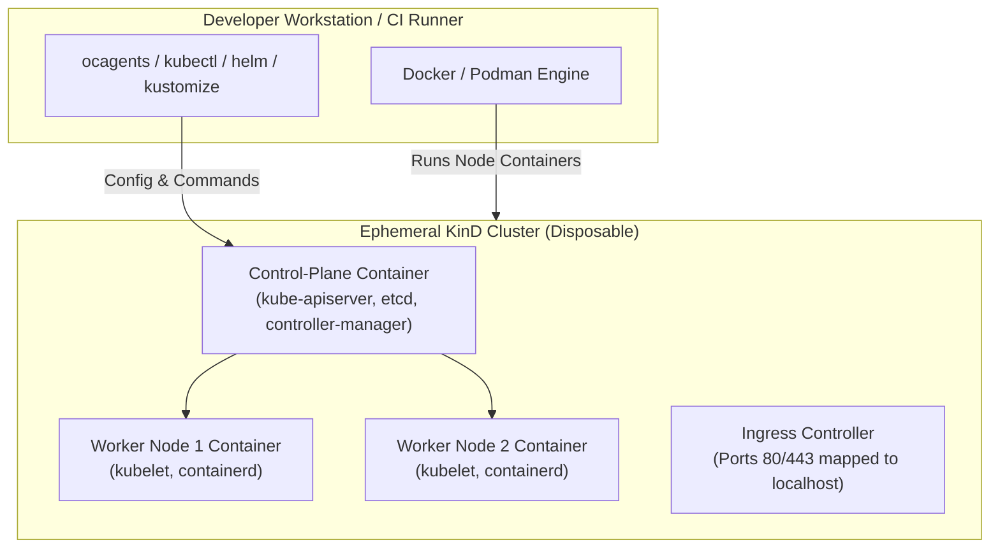

# Kubernetes KinD Sandbox Testing & Manifest Validation

## Purpose & Scope

This skill provides an automated runbook and toolset for executing **ephemeral, isolated Kubernetes sandbox tests** using **KinD (Kubernetes-in-Docker)**. It allows developers, platform teams, and AI agents to validate raw manifests, Kustomize overlays, Helm charts, Custom Resource Definitions (CRDs), and kubectl Krew extensions against a live Kubernetes API server—without requiring cloud credentials or risking staging/production clusters.

---

## 🏛️ Ephemeral Sandbox Architecture



---

## 🚨 The 6 Sandbox Testing Invariants

### 1. Zero Production Blast Radius
* **The Rule:** Tests must execute in an isolated KinD cluster with unique cluster names (e.g. `kind-test-<UUID>`), completely air-gapped from production kubeconfigs.
* **Remediation:** Always specify an isolated kubeconfig: `export KUBECONFIG=$(mktemp -t kind-kubeconfig.XXXXXX)`.

### 2. Multi-Node Topology & NodePort/Ingress Mapping
* **The Rule:** Test manifests against multi-node constraints (`topologySpreadConstraints`, `podAntiAffinity`) and ensure ingress traffic is testable from `localhost:80` and `localhost:443`.
* **Configuration:** Use a dedicated KinD config with 1 control-plane and 2 worker nodes with host port forwardings.

### 3. Local Container Image Sideloading
* **The Rule:** Never push untested local container images to external registries to test them in KinD.
* **Remediation:** Sideload images directly into KinD node runtimes via `kind load docker-image <IMAGE>:<TAG> --name <CLUSTER_NAME>`. Ensure pods declare `imagePullPolicy: IfNotPresent` or `Never`.

### 4. Server-Side Dry-Run & Admission Validation
* **The Rule:** Client-side linting (`kubectl apply --dry-run=client`) only validates syntax; it cannot test schema admission or webhook validation.
* **Remediation:** Run `kubectl apply --server-side --dry-run=server` against KinD to validate object schemas, mutating webhooks, and field immutability.

### 5. CRD Schema & Conversion Lifecycle Testing
* **The Rule:** Validate that Custom Resource Definitions conform to OpenAPI v3 structural schemas and can be reconciled without API server deadlocks.
* **Remediation:** Install CRDs first (`kubectl apply -f crd.yaml`), verify schema registration via `kubectl wait --for condition=established crd/<CRD_NAME>`, then apply custom resource instances.

### 6. Automated Cleanup & Teardown
* **The Rule:** Ephemeral clusters must automatically delete on script completion or failure (`trap "kind delete cluster --name $CLUSTER_NAME" EXIT`).

---

## 🛠️ Step-by-Step Sandbox Testing Workflow

### Scenario A: Testing Raw Manifests or Kustomize Overlays
```bash
# 1. Build and dry-run Kustomize overlay:
kustomize build overlays/production | kubectl apply --dry-run=server -f -

# 2. Deploy into KinD sandbox:
kustomize build overlays/production | kubectl apply -f -

# 3. Wait for pod readiness and zero crashloops:
kubectl wait --for=condition=ready pod -l app=my-service --timeout=90s
```

### Scenario B: Testing Helm Charts with Chart-Testing (`ct`)
```bash
# 1. Lint chart syntax and schemas:
helm lint charts/my-service/

# 2. Template verification:
helm template test-release charts/my-service/ --values charts/my-service/values.yaml

# 3. Ephemeral installation in KinD:
helm install test-release charts/my-service/ --wait --timeout=120s

# 4. Run Helm test suite:
helm test test-release
```

### Scenario C: Testing Kubectl Krew Plugins & Cluster Auditing
```bash
# Use krew plugins inside the isolated KinD context:
kubectl-neat -f deployment.yaml
kubectl-who_can get secrets
kubectl-tree deployment my-service
```

---

## ⚡ Automated Runner Script

Run the automated all-in-one KinD sandbox test suite:

```bash
# Test a raw manifest or directory:
./scripts/run_kind_sandbox.sh --manifest k8s/production/

# Test a Helm chart:
./scripts/run_kind_sandbox.sh --helm charts/my-app/

# Test a Kustomize overlay:
./scripts/run_kind_sandbox.sh --kustomize overlays/prod/
```

---

## ⚠️ Known Edge Cases & KinD Traps

* **`ImagePullBackOff` for Local Images:** KinD nodes run containerd in their own container namespace. If `imagePullPolicy: Always` is set on the pod, kubelet ignores locally sideloaded images and tries pulling from Docker Hub. Set `imagePullPolicy: IfNotPresent`.
* **Inotify / File Watcher Limit Exceeded:** On Linux/WSL2 hosts, running multi-node KinD clusters can exhaust host inotify watches. Fix on host: `sudo sysctl fs.inotify.max_user_watches=524288`.
* **Host Port Conflicts (80/443):** If a local web server (NGINX, Apache) is already running on port 80/443, KinD ingress port binding fails. Use alternative host port mappings (e.g. `8080:80`, `8443:443`).

---

## 📚 References & Scripts

* [kind-cluster-configs-and-ingress.md](references/kind-cluster-configs-and-ingress.md): Multi-node KinD cluster configurations, ingress controller deployment, and containerd registry mirrors.
* [manifest-helm-kustomize-crd-recipes.md](references/manifest-helm-kustomize-crd-recipes.md): Test recipes for Kustomize overlays, Helm chart testing, CRD lifecycle, and Krew extensions.
* [run_kind_sandbox.sh](scripts/run_kind_sandbox.sh): Automated ephemeral cluster lifecycle and testing runner.
