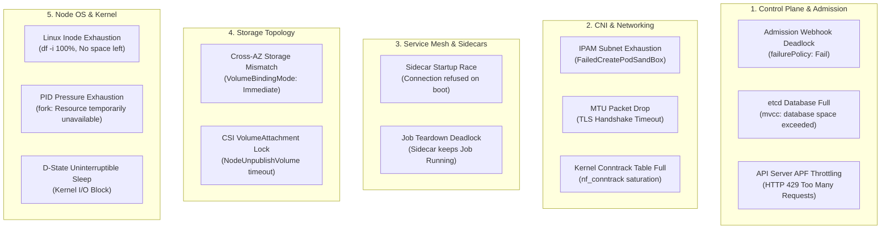

# Kubernetes Advanced Cluster & Control Plane Triage Runbook

This runbook documents the **5 critical cluster-level, kernel-level, and control-plane failure categories** that extend beyond single-pod lifecycles:

1. **Control Plane & Admission Webhooks**
2. **CNI Networking & Kernel Traps**
3. **Service Mesh & Sidecar Lifecycle Races**
4. **Storage Topology & Multi-AZ Allocation**
5. **Node OS, Inodes & Kernel Pressure**

---

## 🏛️ Master Architecture Failure Map



---

## 1. 🎛️ Control Plane & Admission Webhooks

### A. Admission Webhook Self-Deadlock

```
[New Pod Scheduled] ──► [kube-apiserver] ──► [Webhook: failurePolicy: Fail]
                                                    │
                                                    ▼
                                          [Webhook Pod DOWN]
                                                    │
                                                    ▼
                                          [Cluster Admission Frozen]
```

* **Symptoms:** No new pods or deployments can be scheduled in any namespace; `kubectl apply` hangs for 30s and returns `Internal error occurred: failed calling webhook`.
* **Root Cause:** A `ValidatingWebhookConfiguration` or `MutatingWebhookConfiguration` configured with `failurePolicy: Fail` intercepts all namespaces (including `kube-system` or its own namespace). When the webhook controller restarts or node drains occur, the webhook cannot admit its own replacement pod.
* **Triage Sequence:**
  ```bash
  # 1. Identify active admission webhooks:
  kubectl get validatingwebhookconfigurations,mutatingwebhookconfigurations

  # 2. Inspect failurePolicy and namespace selectors:
  kubectl describe validatingwebhookconfiguration <NAME> | grep -E "(Failure Policy|Namespace Selector)"
  ```
* **Immediate Remediation:**
  ```bash
  # Temporarily patch failurePolicy to Ignore during recovery:
  kubectl patch validatingwebhookconfiguration <NAME> --type='json' \
    -p='[{"op": "replace", "path": "/webhooks/0/failurePolicy", "value": "Ignore"}]'
  ```
* **Production Guardrail:** Always exempt `kube-system` and critical system namespaces using `namespaceSelector.matchExpressions`:
  ```yaml
  namespaceSelector:
    matchExpressions:
      - key: kubernetes.io/metadata.name
        operator: NotIn
        values: ["kube-system", "kube-node-lease", "cert-manager"]
  ```

---

### B. etcd Database Space Exceeded

* **Symptoms:** `kube-apiserver` logs `etcdserver: mvcc: database space exceeded`. Read operations succeed, but all creation/update requests fail with `HTTP 500`.
* **Root Cause:** etcd storage reached its hard quota (default 2GB; maximum recommended 8GB) due to high event turnover, unpruned Helm release secrets, or missing compaction.
* **Triage Sequence:**
  ```bash
  # Check etcd endpoint database size and alarm status:
  etcdctl endpoint status --write-out=table
  etcdctl alarm list
  ```
* **Immediate Remediation:**
  ```bash
  # 1. Get current etcd revision:
  rev=$(etcdctl endpoint status --write-out=json | jq -r '.[0].Status.header.revision')

  # 2. Compact old revisions:
  etcdctl compact "$rev"

  # 3. Defragment backend storage to reclaim physical space:
  etcdctl defrag

  # 4. Disarm the space quota alarm:
  etcdctl alarm disarm
  ```

---

### C. API Server Priority & Fairness (APF) Throttling

* **Symptoms:** Controllers and CI runners receive intermittent `HTTP 429 Too Many Requests`.
* **Root Cause:** Unbounded `LIST/WATCH` requests from custom controllers or security daemonsets saturate the API server's allocated request seats.
* **Triage Sequence:**
  ```bash
  kubectl get flowschemas,prioritylevelconfigurations
  # Inspect API server dropped request metrics in Prometheus:
  # sum(rate(apiserver_flowcontrol_rejected_requests_total[5m])) by (flow_schema)
  ```
* **Production Guardrail:** Enforce paginated chunking (`--limit=500`) on custom controllers and verify client informers use SharedIndexInformer rather than polling.

---

## 2. 🌐 CNI & Advanced Networking Traps

### A. IPAM Subnet Exhaustion (`FailedCreatePodSandBox`)

* **Symptoms:** New pods stay in `ContainerCreating` with warning event: `FailedCreatePodSandBox: failed to allocate for range: no IP addresses available in network`.
* **Root Cause:** Node subnets in AWS EKS (VPC CNI), Azure AKS (Azure CNI), or Google GKE ran out of available private IP addresses.
* **Triage Sequence:**
  ```bash
  kubectl describe pod <POD_NAME> -n <NAMESPACE> | grep -A 5 FailedCreatePodSandBox
  # On AWS: check secondary ENI IP allocation:
  kubectl get eniconfigs -A
  ```
* **Production Guardrail:**
  1. Add a non-routable secondary CIDR (e.g. `100.64.0.0/16`) dedicated exclusively to pod IPs.
  2. Tune AWS VPC CNI environment variables to avoid hoarding unused IP addresses:
     ```yaml
     WARM_IP_TARGET: "5"
     MINIMUM_IP_TARGET: "10"
     ```

---

### B. MTU Mismatch & Silent Packet Drops

* **Symptoms:** ICMP `ping` and small curl requests succeed, but HTTPS/TLS handshakes or large HTTP POST payloads hang indefinitely and time out after 60 seconds.
* **Root Cause:** Encapsulated CNI overlay packets (Geneve, VXLAN, Cilium, Calico) add 50 bytes of header. The pod's virtual interface has MTU 1500, but the underlying host network MTU is 1500, causing packets $> 1450$ bytes with `DF` (Don't Fragment) bit set to drop silently without returning an ICMP fragmentation needed packet.
* **Triage Sequence:**
  ```bash
  # Inside a debug pod: test packet transmission with Don't Fragment bit:
  ping -M do -s 1472 <TARGET_INTERNAL_IP>
  ```
* **Production Remediation:** Configure CNI interface MTU to 1450 (or 8950 on Jumbo Frame networks):
  ```bash
  # Example for Calico:
  kubectl patch installation default --type=merge -p '{"spec": {"calicoNetwork": {"mtu": 1450}}}'
  ```

---

### C. Kernel Conntrack Saturation

* **Symptoms:** Random socket timeouts (`connection timed out`) across all pods on a single node.
* **Root Cause:** Microservices making high-frequency outbound HTTP calls without connection pooling fill the host Linux `nf_conntrack` table (`kernel: nf_conntrack: table full, dropping packet`).
* **Triage Sequence:**
  ```bash
  # On host node:
  sysctl net.netfilter.nf_conntrack_count net.netfilter.nf_conntrack_max
  ```
* **Production Remediation:**
  1. Deploy NodeLocal DNSCache DaemonSet to handle DNS queries locally over TCP.
  2. Configure HTTP client connection pooling (keep-alive) in applications to eliminate ephemeral TCP socket churn.

---

## 3. 🛡️ Service Mesh & Sidecar Lifecycle Races

### A. Sidecar Startup Race Condition

* **Symptoms:** Pod in `CrashLoopBackOff`: Application crashes on line 1 with `Connection refused` or `Host is unreachable` when attempting to connect to databases or APIs during startup.
* **Root Cause:** The application container booted and initiated outbound TCP calls before the service mesh proxy (`istio-proxy`, `linkerd-proxy`, or Vault agent) finished setting up iptables traffic redirection.
* **Production Remediation:**
  * **Option 1 (Kubernetes $\ge$ 1.28 Native Sidecars):**
    ```yaml
    initContainers:
      - name: istio-proxy
        image: docker.io/istio/proxyv2:1.24.0
        restartPolicy: Always   # Native sidecar: runs for the lifetime of the pod
    ```
  * **Option 2 (Istio Hold Proxy Setting):**
    ```yaml
    spec:
      template:
        metadata:
          annotations:
            proxy.istio.io/config: '{"holdApplicationUntilProxyStarts": true}'
    ```

---

### B. Sidecar Teardown Deadlock in Batch Jobs

* **Symptoms:** Kubernetes `Job` runs its main container to completion (`exit 0`), but the Pod remains `Running (1/2)` indefinitely, blocking the Job controller from marking it `Completed`.
* **Root Cause:** The proxy sidecar does not know the primary batch process completed and keeps listening for inbound traffic.
* **Production Remediation:** Add a trap script to send the quit signal to the proxy on exit:
  ```bash
  trap "curl -fsI -X POST http://localhost:15020/quitquitquit" EXIT
  ```

---

## 4. 💾 Storage Topology & Multi-AZ Allocation

### Cross-AZ Storage Binding Mismatch

* **Symptoms:** Pod stuck in `Pending` with scheduling failure: `0/N nodes available: 1 node(s) had volume node affinity conflict`.
* **Root Cause:** The `StorageClass` has `volumeBindingMode: Immediate`. The volume (AWS EBS / GCP Persistent Disk) was created in Availability Zone `us-east-1a`, but when the pod was scheduled, only nodes in `us-east-1b` had sufficient CPU/RAM capacity. Because EBS/PD volumes cannot cross AZ boundaries, the pod cannot start.
* **Production Remediation:**
  **Invariant:** Never deploy production cloud block storage with `Immediate` binding mode. Always use `WaitForFirstConsumer`:
  ```yaml
  apiVersion: storage.k8s.io/v1
  kind: StorageClass
  metadata:
    name: ebs-gp3-delayed
  provisioner: ebs.csi.aws.com
  volumeBindingMode: WaitForFirstConsumer  # Delays provisioning until pod is scheduled to an AZ
  allowVolumeExpansion: true
  ```

---

## 5. 🐧 Node OS, Inodes & Kernel Pressure

### A. Linux Inode Exhaustion (`DiskPressure`)

* **Symptoms:** Containers fail with `No space left on device` or `failed to write file`, but running `df -h` shows 80% free disk capacity.
* **Root Cause:** Filesystems have two resource limits: physical storage (blocks) and index nodes (inodes). Logging daemons, container storage layers, or applications generating millions of tiny cache files consume 100% of inodes (`df -i` shows 100%).
* **Triage Sequence:**
  ```bash
  # Check inode saturation:
  df -i /var/lib/docker /var/lib/containerd
  ```
* **Production Remediation:**
  ```bash
  # Purge dangling container image layers:
  crictl rmi --prune
  # Clean up dead container log files:
  find /var/log/pods -type f -name "*.log" -size +50M -delete
  ```

---

### B. PID Limit Exhaustion (`PIDPressure`)

* **Symptoms:** Node condition flips to `PIDPressure: True`. Containers fail to start with `fork: retry: Resource temporarily unavailable`.
* **Root Cause:** A process leak (e.g. unmanaged Java thread pools, orphan bash loops) exhausts the OS maximum Process IDs (`kernel.pid_max`).
* **Production Remediation:** Restrict maximum PIDs at the container cgroup level:
  ```yaml
  spec:
    containers:
      - name: worker
        resources:
          limits:
            pids: 1024
  ```

---

## 📚 Related References
- [The 25 Universal Failure States Cheat Sheet](k8s-production-troubleshooting-cheatsheet.md)
- [Diagnostic Decision Tree & Exit Codes](k8s-pod-diagnostic-decision-tree.md)
- [The 10 DevSecOps Production Non-Negotiables](../../helm-chart-scaffold/references/k8s-production-non-negotiables.md)
- [Master Agent Directive (AGENTS.md)](../../../../../AGENTS.md)
